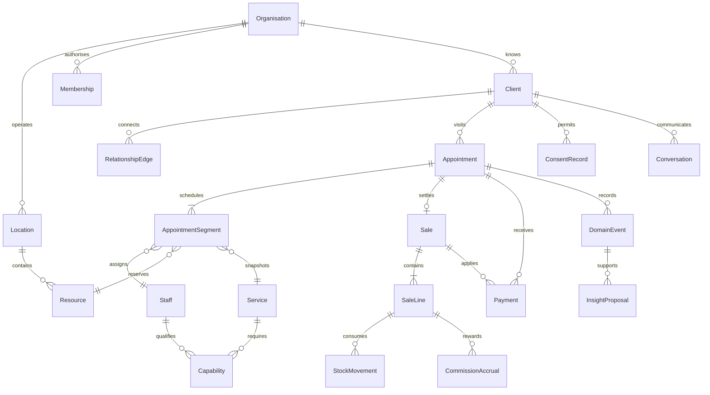

# SALEANE architecture

Local V1 candidate · 6 October 2026. The implemented authority is a localhost Node service with SQLite. Hosted infrastructure, managed identity, payment, messaging and model providers remain unconfigured at the user's explicit request.

## Implemented application

Vite + React + TypeScript, React Router, Saleane CSS tokens and locally bundled fonts. Radix supplies dialog semantics beneath the custom component layer. The original ivory/sage/serif photographic direction remains the design authority. Management and account routes are loaded on demand.

```text
src/domain/                 Versioned schemas, commands, scoped links, time and money rules
src/state/StoreProvider     Async server writes, browser demo adapter, recovery, retry journal
src/pages/                  Daily loop, accounts, guest booking, Manage, Inbox, Money
server/app.ts               Same-origin request checks and route dispatch
server/context.ts           Sessions, tenant lookup, holds, persistence and audit helpers
server/routes/              Account, workspace and public-booking route modules
server/projections.ts       The single seam where workspace records leave the server
server/database.ts          Numbered SQLite migrations, transactions, receipts and audit
server/auth.ts              Salted password hashing and opaque session material
server/index.ts             Loopback-only built app + API host
server/backup.ts            Consistent backup, verification and fresh-path restore
```

`npm run dev` serves UI and API through one Vite listener on **127.0.0.1:5173**. `npm run build && npm start` serves the built UI and API through one Node listener at the same address. Stop one before starting the other. The database is `.saleane-data/saleane.sqlite`, excluded from Git with its WAL files; the public build must never contain it. The built host rejects a database or WAL/SHM path inside the static root, including symlink/prospective path aliases, before opening SQLite. See [server runbook](../server/README.md) for configuration, exact API and recovery commands.

An account owns explicit organisation memberships. Professional capability is a separate record. Owner, manager and reception access are checked on every server command. Restricted practitioner access is intentionally unavailable until assigned-client read projections exist; the server rejects its creation. A studio is one location and currency. Multiple studios can coexist without sharing records; this is not group reporting or multi-location operations.

The local database uses scoped organisation snapshots plus relational accounts, memberships, sessions, invitations, command receipts, guest holds and audit events. Transactions validate expected revision, permission and domain references before replacing the snapshot. The public API returns a limited catalogue and available times, never clients or histories. It allocates professional and exact room under a short-lived hold and revalidates inside confirmation. This small local authority is not the future relational aggregate implementation or a distributed service.

Async screen saves show success only after a committed response. A privacy-preserving retry journal retains hashed command identity and request UUID across refresh/remount; no operator command body is stored in it. Guest confirmation separately retains its exact submitted contact/consent and hold snapshot in that tab’s session storage until a definitive response, so a reload/expired timer cannot create another booking while confirmation is unknown. Successful/definitively rejected confirmations clear that recovery snapshot. Uncertain transport failures reuse the key. Stale revisions refresh authoritative records while leaving the user's form available to review. Workspace transitions reject new writes and discard late responses from another workspace. Server receipts recheck current permission before replay.

A new local studio starts without clients, appointments or funds. It uses the venue's current civil day and rejects elapsed/nonexistent/ambiguous booking times. Hours, closures, qualified staff and resources determine availability. A separate explicit sample studio uses 6 October 2026 and simulated funds. The original browser demo and `saleane.demo.v1.UK` / `.US` snapshots remain intact; neither implies authenticated server storage.

Appointments preserve booked service name, duration, buffer, price, deposit terms and original resource category. Manual receipts, deposits and external refund records require explicit provenance; they never imply a processor call. Tax is configured by the operator and snapshotted at checkout, not determined by a tax engine. Message drafts/queues remain unsent and consent is checked at queue time. No delivery worker exists. Reports derive from the same receipt/visit model; historical utilisation uses the current schedule because schedules are not yet versioned.

Client imports are bounded and reviewed, have a source label and do not infer marketing consent or merge identity on email. Backup uses a consistent SQLite snapshot; restore validates into a fresh destination and revokes sessions/invitations/holds. The local file is not encrypted by this application; hosted encryption, key management, account recovery, privacy erasure and monitored operational recovery remain release gates.

See [local domain contract](V1_LOCAL_CONTRACT.md) and [candidate evidence](evidence/VERIFICATION_1.0.0-rc.1.md) for accepted rules and measured limits.

## End-state domain

**Relational records, explicit edges, durable events.** PostgreSQL is the target category of database; vendor/region remains a decision. A separate graph database is not required to express client relationships. Start with a modular TypeScript service and one transactional database rather than a separate service per screen.



The diagram is the target contract, not a claim that every table exists in the local candidate. Current implementation uses one service segment on each appointment and a service-only sale; multi-segment visit and sale-line migration must preserve those IDs and snapshots.

| Aggregate / seam        | Stable information                                                                | Owning authority / growth                                                  |
| ----------------------- | --------------------------------------------------------------------------------- | -------------------------------------------------------------------------- |
| Organisation/location   | IDs, country, base currency, IANA zone, policy versions                           | Account service; future multi-brand groups require explicit sharing grants |
| Membership/staff        | Actor ID, roles, location scopes, capabilities and hours                          | Server policy; employee/contractor/renter distinct from permissions        |
| Client/relationship     | Stable tenant ID, contact channels, explicit typed edges, source mapping          | Relationship module; household/referral never inferred automatically       |
| Service/version         | Location price, duration, buffer, capabilities and resource needs                 | Catalogue; snapshots survive later editing                                 |
| Appointment/segments    | Client/location, service snapshots, staff/resource intervals, status/version      | Scheduling module; holds and reschedules atomic                            |
| Sale/lines              | Service/retail amounts, tax policy snapshot, currency, tip, adjustments           | Money module; settlement and immutable adjustment history                  |
| Payment/refund          | Provider IDs, purpose, amount, currency, status and allocation                    | Provider adapter plus verified webhook ledger                              |
| Product/stock movement  | Product/location, quantity/unit, reason, visit or sale-line link                  | Inventory module; append/reverse rather than overwrite balances            |
| Commission accrual      | Recipient, rule version, qualifying sale line, adjustment                         | People/money seam; compensation is not calendar availability               |
| Consent/conversation    | Purpose/channel, policy version, source, withdrawal, delivery states              | Communication module; suppression enforced at send-time                    |
| Domain event/outbox     | Event type/version, actor, tenant, subject IDs, correlation/causation             | Transactional write with aggregate; delivery retries safe                  |
| Insight/action proposal | Definition/version, permissioned sources, evaluation/confidence, proposed command | Intelligence reads projections; actions return to authorised modules       |

## Production authority and API contract

1. Authenticate the actor; resolve organisation membership and action/location scope on the server.
2. Validate an input schema and idempotency/correlation key.
3. Check capability, money or availability invariants inside the same transaction as the write.
4. Use scoped references and version constraints. The server returns a conflict when expected version is stale.
5. Commit domain records and an outbox event together.
6. Let jobs deliver notifications/build projections from the outbox. Delivery receipt is distinct from queued intent.
7. Return a stable record/command result. Client success requires committed authority; provider success requires verified provider result.

Suggested commands (contracts to implement, not existing endpoints):

| Command                                    | Input / guard                                                                        | Result / conflict                                         |
| ------------------------------------------ | ------------------------------------------------------------------------------------ | --------------------------------------------------------- |
| `POST /organisations/:orgId/booking-holds` | Location, qualified segments, requested time, short expiry, public/session authority | Hold ID/expiry; 409 unavailable; rate-limited             |
| `POST .../appointments`                    | Hold, verified client/details, policy consent, deposit state, idempotency key        | Confirmed visit or explicit pending-payment state         |
| `POST .../appointments/:id/arrive`         | Expected version, permitted operator, arrival window                                 | Versioned arrival event; 409 invalid transition           |
| `POST .../sales`                           | Visit, price snapshot, tax version, optional tip, actual deposit allocation          | Sale/payment intent; unique visit settlement key          |
| `POST .../payments/webhook`                | Signature, provider event ID, permitted account mapping                              | Deduplicated ledger transition; rejected unmapped event   |
| `POST .../appointments/:id/rebook`         | Completed origin, same client, new valid hold                                        | Linked next visit; conflict preserves previous settlement |
| `POST .../clients/:id/notes`               | Ordinary data classification, permitted client scope                                 | Attributed note event                                     |
| `POST .../consents`                        | Channel/purpose/policy/source/action                                                 | Immutable grant/withdrawal event and current projection   |

A URL orgId is not authorisation. PostgreSQL scoped composite foreign keys or equivalent verified constraints must prevent references to another organisation. Queries, jobs, exports, webhooks and AI tools must carry the same tenant context. A generated UI permission check alone cannot satisfy this.

## Scheduling and time

Production scheduling stores UTC start/end instants, venue IANA zone and source civil-time intent. Service segments reserve staff and resource intervals with configured treatment, processing and cleanup policies. Reject nonexistent local times; resolve ambiguous times explicitly and test UK/US DST boundaries.

Use database-supported non-overlap constraints/locks plus transactional revalidation. A public hold has an expiry and cannot reserve capacity forever. Provider callbacks may race hold expiry: the state machine must resolve late capture through a documented reconciliation/refund path rather than inventing a confirmed visit. Test simultaneous guest and desk requests for the last room.

Reschedule is a new attributed allocation change with history; it is not drag-and-drop updating a display field. Every interaction has a non-drag accessible path.

## Money and providers

Minor-unit amounts always carry currency. Service/retail tax inclusion and classifications are explicit and versioned per location. Tips remain separately reportable/allotted. Deposit capture, liability, application, refund and forfeiture require distinct ledger reasons.

Use provider-hosted/tokenised card entry; never put card numbers in application state or logs. Signed, deduplicated webhooks map provider account and event to the correct tenant. Out-of-order or replayed delivery cannot double-settle. Daily reconciliation compares ledger to provider captures/refunds/fees; exported reports disclose recognition dates and tax treatment.

v0.2 simulates a deposit at booking and a settlement at checkout. Service revenue ignores the deposit payment amount and uses the completed service sale exactly once. No card-on-file, VAT/sales-tax invoice, refund or payment certification is implemented.

## Communication and intelligence

Transactional appointment messages and marketing have distinct purposes, templates and permission policies. Consent withdrawal changes eligibility before any future send. Delivery attempts/receipts and suppression are linked to client/conversation/appointment IDs. The present email boolean/events are a demo surface for a future consent ledger, not a jurisdiction-complete policy.

Intelligence is initially a deterministic projection with visible provenance. Later model adapters can summarise permissioned facts and propose a command. An action requires an authorised actor, exact preview and appropriate approval. Neither model text nor retrieved client messages can override permissions, deposit/cancellation policy or the clinical boundary. Evaluate recommendations and errors with a versioned fixture/pilot set; store action provenance.

Concierge is a client of these contracts. Voice/SMS/web channels do not receive raw database write authority.

## Clinical boundary

Core Saleane permits ordinary non-clinical service preferences only. Do not add diagnoses, medications, clinical forms, treatment images or health-derived segments to its free-text model as a shortcut.

Saleane Clinical requires jurisdiction/entity assessment, appropriate contracts (including BAA where applicable), data classification/retention, clinical permissions, audit and incident procedures, provider suitability and specialist validation. Plan a separately governed datastore/access boundary and explicitly authorised references if core operations need shared identity. Clinical records cannot enter generic marketing, benchmarking or model context by default. No compliance label is earned by adopting this architecture.

## Persistence, migrations and operations

Prototype schema migration currently rejects unknown versions and offers preserved-byte export/reset. Production needs tracked migrations, scoped import mapping, reviewed duplicate handling and tested rollback. Never reinterpret history after a service/tax/time-zone change.

Before pilot: backups and restore drill; retention/export/erasure procedure; secret rotation; audit/log redaction; monitoring for booking conflict/payment failures; incident owner; provider outage runbook; actual supported-browser and performance measurements. Public SPA route fallback must be configured on the chosen host for direct route access. No host is presently configured.

## Current technical risks and intentionally missing capabilities

LocalStorage has no atomic cross-tab transaction, trusted authorisation, encryption boundary or collaborative live updates. A very short simultaneous-write race remains despite revision checks. Demo schema validation catches malformed scoped links but is not a complete forensic ledger validator. The daily opening-hours model ignores closures and actual staff shifts. Guest client identity is unverified. Reports use visit date and simplified denominators. Tax, refunds, provider reconciliation, inbox, inventory, commissions, memberships and Clinical are not implemented.

Those boundaries make 0.3–0.6 necessary. Keep the current UI/domain vocabulary, move state authority to a transactional service, and add real evidence before claiming V1.

## Continuity contracts recovered from the source conversation

Read [PROJECT_CONTEXT](PROJECT_CONTEXT.md), [UX_ARCHITECTURE](UX_ARCHITECTURE.md) and the PRD together. Screens are projections of durable records, not independent databases. The prototype is 0.2.2; the unverified server draft is preserved separately on `wip/saleane-server-authority` at `f73d084` and is not part of the reviewed app.

- **Daily brief:** attention items carry source IDs, evaluation time, definition version and an available command. “Done for you” requires an actual action receipt. Calendar capacity, relationship history and money share organisation/location scope.
- **Read-only continuity:** a future authorised daily snapshot contains the minimum appointment/client display fields, actor/scope, issued time and expiry. Logout, role removal and tenant change invalidate access. Offline writes, payments, identity edits and new bookings are unavailable. This snapshot mechanism is specified, not implemented.
- **Migration:** imports stage immutable source rows with batch IDs and external-to-internal mappings. Preview, duplicate review, counts and money reconciliation precede commit. Source consent is evidence, never automatic permission to market. No card credentials are imported through CSV. Re-runs must not duplicate records.
- **Relationship expansion:** membership, consultation and aftercare events attach to existing client IDs; inbox threads and delivery receipts attach to consent purpose and visit IDs. Retail stock and professional consumption use distinct movement reasons. Commission rules snapshot eligibility rather than changing old sales when a staff rule changes.
- **Interface evolution:** side-panel appointments reuse the same command authority as calendar/checkout. Imagery, serif branding and the three study expressions do not introduce extra source records or fork the product's domain. The current static studies are visual experiments, not another booking engine.

The next server slice must prove two competing booking attempts, replayed checkout, unauthorised tenant access, restart persistence and recoverable migration against a real transactional database before replacing browser authority. Production provider, backup, legal and deployment gates remain separate.
