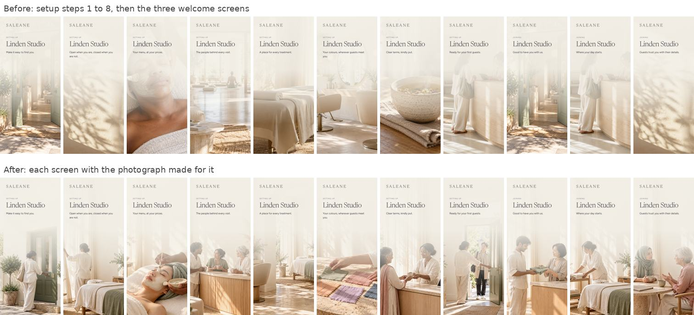
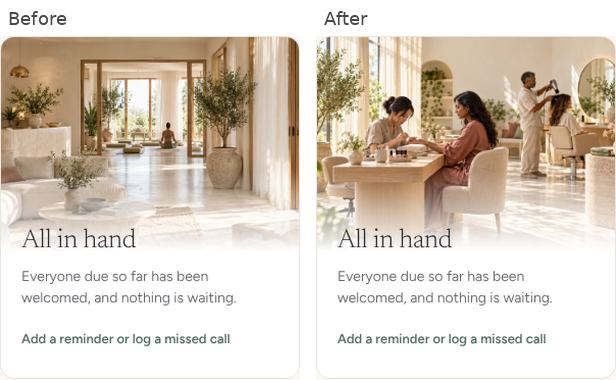
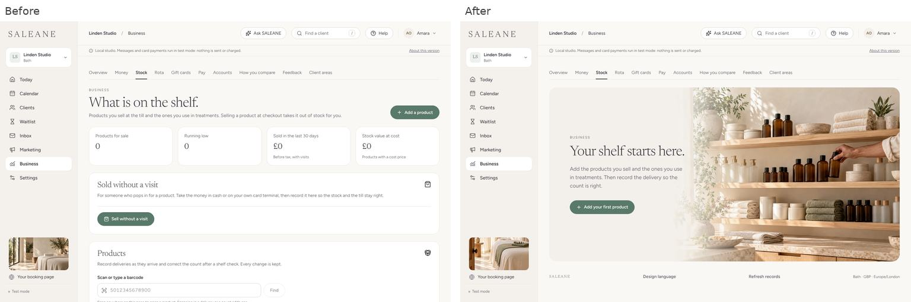
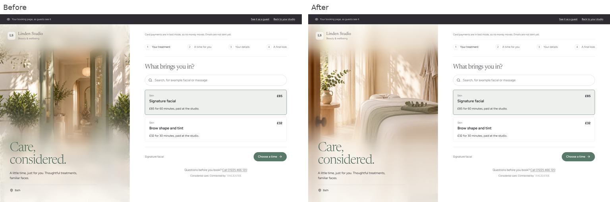
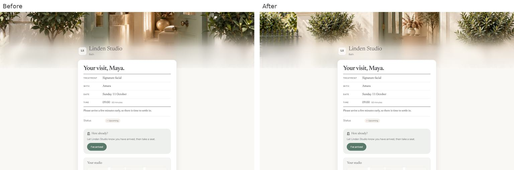
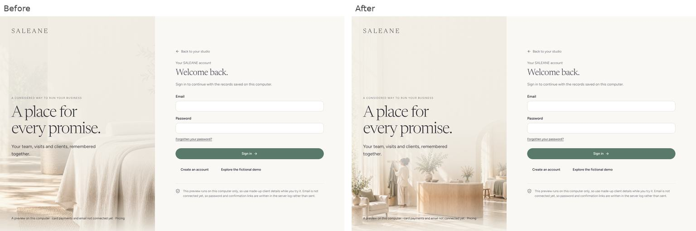
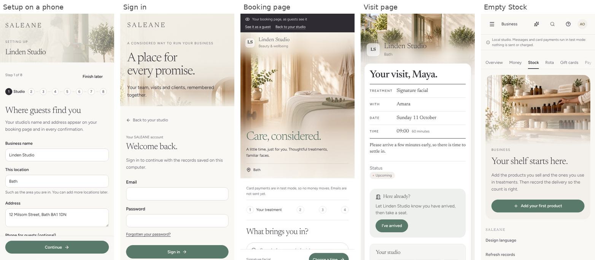
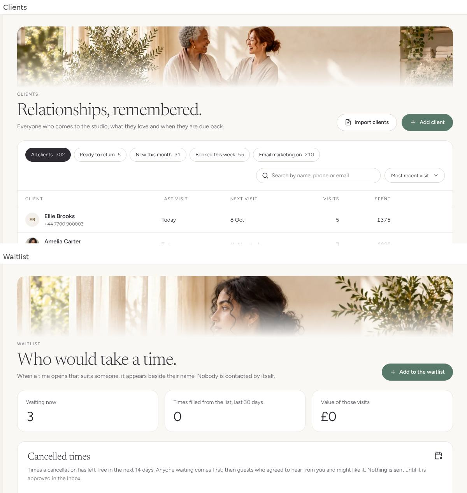
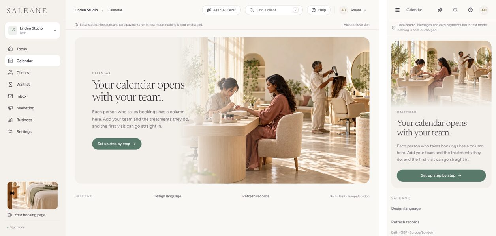

# The 21 app photographs, in place (11 October 2026)

The 21 photographs made from `docs/photo-prompts.md` (PR #93) now show on the screens they were made for. Each comes from `src/design/photos.ts`, like every other house photograph. They are fictional and AI-made, and are never shown as a real studio's premises or people.

## Where each one goes

| Photograph                   | Screen                                                                                  | Replaces                     |
| ---------------------------- | --------------------------------------------------------------------------------------- | ---------------------------- |
| `setup/setup-*.webp` (8)     | The eight steps of Set up your studio                                                   | Borrowed library photographs |
| `welcome/welcome-*.webp` (3) | The three welcome screens for someone joining the team                                  | Entrance, reception, window  |
| `screens/sign-in.webp`       | Sign in, create an account and the invitation page                                      | `saleane-studio-warm.jpg`    |
| `screens/booking-page.webp`  | The booking page, and its small previews (sidebar, Settings, setup Look step, Business) | Entrance and reception       |
| `screens/guest-visit.webp`   | The band on a guest's visit page                                                        | Entrance                     |
| `screens/today.webp`         | Under the greeting on Today                                                             | Sunlit treatment room        |
| `screens/calendar.webp`      | The "All in hand" card on Today, and the Calendar's welcome while nobody is on the team | Calm studio, hair studio     |
| `screens/clients.webp`       | The Clients band, and the welcome on an empty Clients page                              | Window light, reception      |
| `screens/stock.webp`         | The welcome on an empty Stock page (new)                                                | None                         |
| `screens/closing-up.webp`    | The closing-up card on Business                                                         | End of day room              |
| `screens/waitlist.webp`      | The Waitlist band, and the welcome on an empty Waitlist                                 | Tea moment                   |
| `screens/next-visit.webp`    | The next visit after checkout, and "SALEANE noticed" on Today                           | Tea moment                   |

Calendar and Stock are working tools with no photo band (Page tops, `src/design/pageTops.test.ts`), so their two photographs go where the prompt list's intent fits: the calendar picture shows everyone busy with a guest on the card that says everyone due has been welcomed, and again on the polish pass's Calendar welcome ("Your calendar opens with your team."), and the stock picture welcomes a new studio to an empty shelf.

An empty Stock page now follows the quality bar's "lovely empty pages" rule, as Clients and Waitlist already do: one welcome with the photograph, one line and "Add your first product", in place of four figures at zero, an empty counter sale panel and an empty products panel. Once a product or a stock change exists, the page is as before.

Each tall photograph has its own anchor, so its subject stays in view where the picture narrows to a short band on a phone. On a phone the sign-in picture's figure sits just below the words. The bands on Clients, Waitlist and the visit page and the "SALEANE noticed" picture are anchored on faces and the open doorway.

`setup-deposits.webp` and `today.webp` arrived as empty files and were saved again from their PNG originals at quality 80; both now match the checksums in `docs/assets/app-photographs-2026-10-10.json`. The pictures moved from `public/images/library/app/` into `setup/`, `welcome/` and `screens/`.

## What was checked

A browser script took every changed screen before and after at 1440 and 390 pixels wide: a new studio (Linden Studio) through all eight setup steps, Today, the "All in hand" card once its one guest had been welcomed, empty Clients, Waitlist and Stock pages, the booking page, a guest booking through to their visit page, and a new team member's invitation and welcome; and the Atelier House demo for Today, Clients, Waitlist, the closing-up card, "SALEANE noticed" and a checkout through to the next visit. No console errors appeared beyond the expected signed-out account calls. After the polish pass's latest work was brought in, a new studio was walked through again: the Calendar's welcome shows the calendar photograph on both widths, an empty Stock page shows its welcome, adding a first product opens the full Stock page, and recording a delivery shows the polish pass's corner notice ("Delivery of 6 recorded for Rose cleansing balm. 6 in stock."). Lint, all 1,969 app tests and all 646 server tests pass, as do the production build and `npm run format:check`.

