# Clean white, a background a studio can choose

Recorded 3 November 2026 on a local build (Chromium, 127.0.0.1:5173). "Warm ivory" is SALEANE's original look and stays the default; "Clean white" is the new choice. The pictures use the browser demo (Atelier House, Tuesday 6 October 2026) and a fresh signed-up studio (Linden Rooms, fictional) for the setup screens. The white pictures also pick the new first colour, Deep green (#2f6b4f), the green on the public homepage draft.

The idea came from Edem on 3 November 2026, after the colour directions page (https://claude.ai/artifact/CuE82s3gXMs36nVLqSAJJv): "what about a cleaner version of the app white native", then "add this clean white theme please as an option". The rule is decision 19 in [DESIGN_LANGUAGE.md](../DESIGN_LANGUAGE.md#colour).

## What a studio chooses

Settings, Booking page & colours, Studio look, and the Look screen of Set up your studio, now ask three things: Background (Warm ivory or Clean white), First colour and Second colour. The choice is kept with the studio, so every location, device and guest sees it, like the two colours already were. A studio that never chooses stays on warm ivory, and a look saved before this change reads as warm ivory.

## What changes on clean white

| Part                             | Warm ivory (unchanged) | Clean white                |
| -------------------------------- | ---------------------- | -------------------------- |
| Pages and panels                 | #faf8f5                | #ffffff                    |
| Sidebar and quiet fills          | warm stone             | soft cool grey #f6f7f7     |
| Lines                            | warm hairlines         | cooler hairlines #ebecec   |
| Words                            | warm ink               | crisper near-black #141716 |
| Quieter words                    | warm grey              | #676c6a                    |
| Soft tint of the first colour    | 10% into ivory         | 9% into white              |
| Photo fades on the booking page  | into ivory             | into white                 |
| Page around a visit email's card | #faf8f5                | #f6f7f7                    |

The studio's two colours, the photographs, the serif headings and every layout stay as they are.

| Warm ivory                                                                  | Clean white with Deep green                                                   |
| --------------------------------------------------------------------------- | ----------------------------------------------------------------------------- |
| 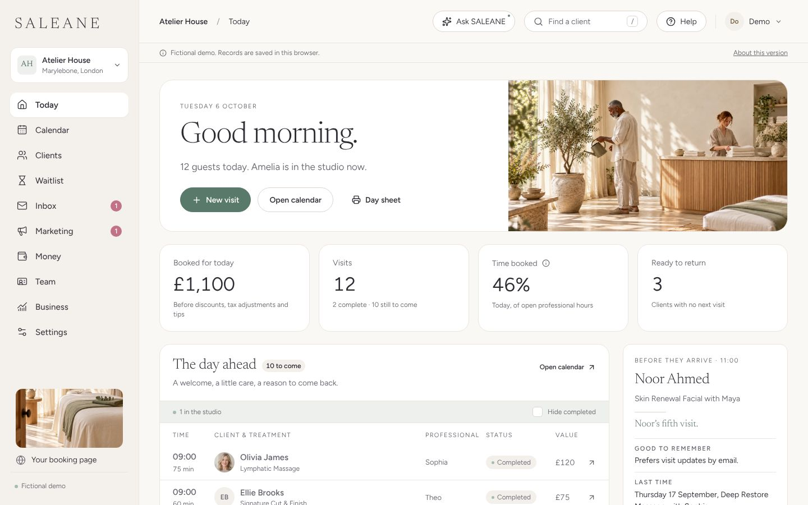                    | 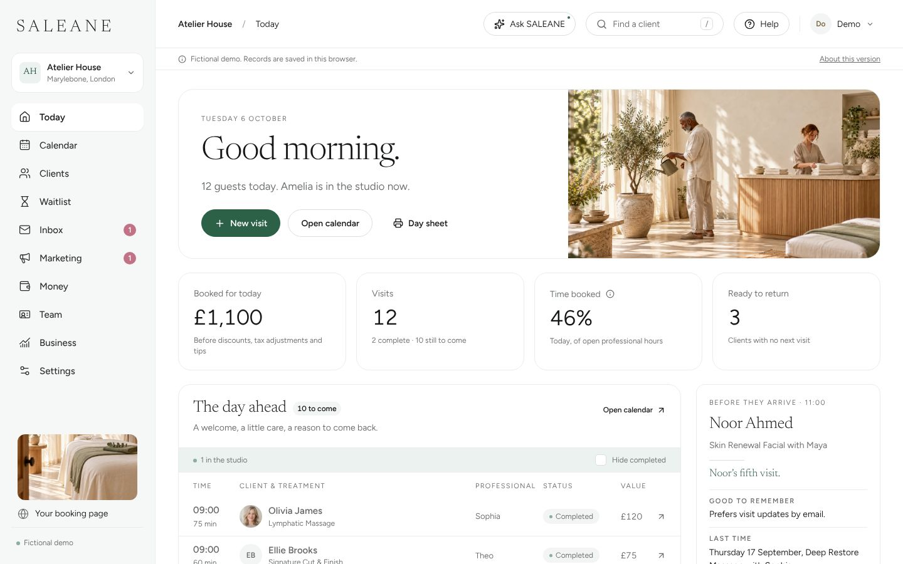                    |
| 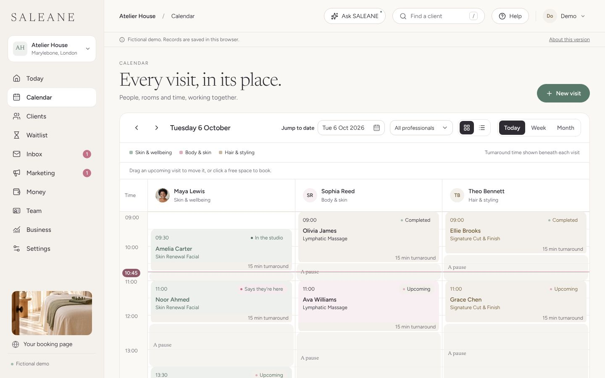              | 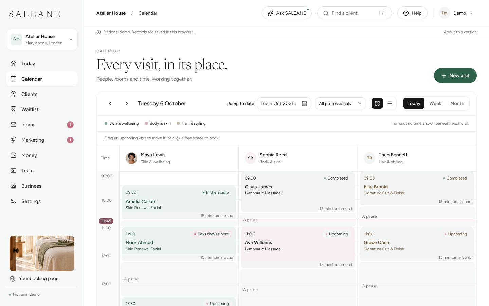              |
| 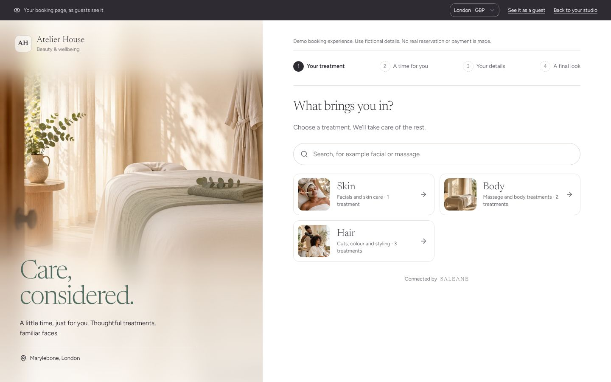           |            |
| 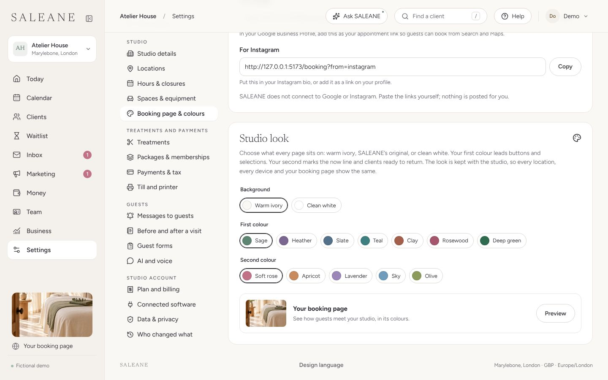              | 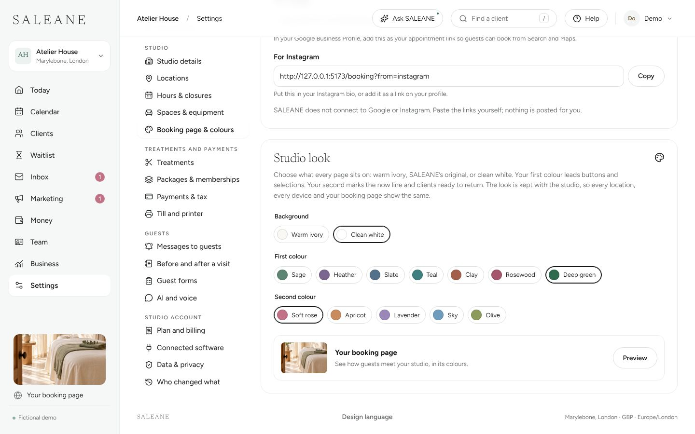              |
| 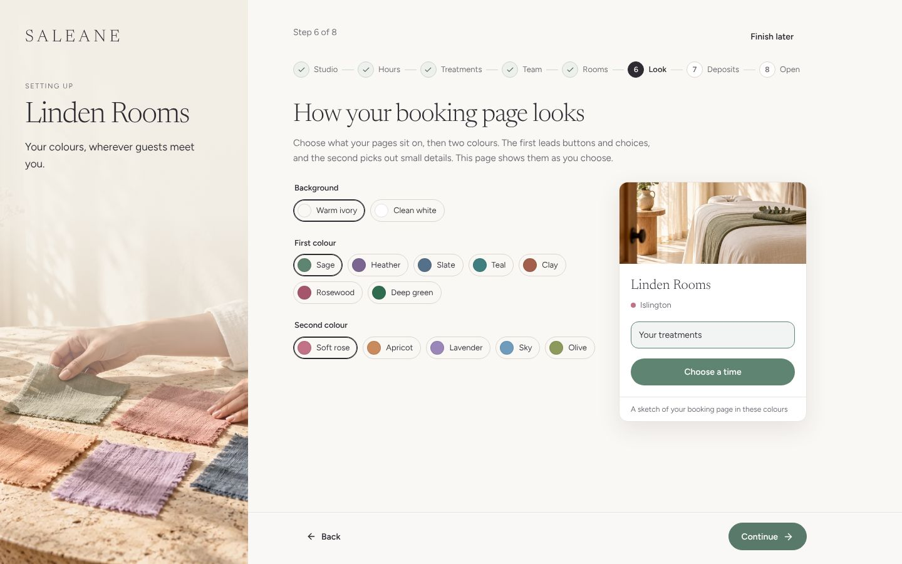        | 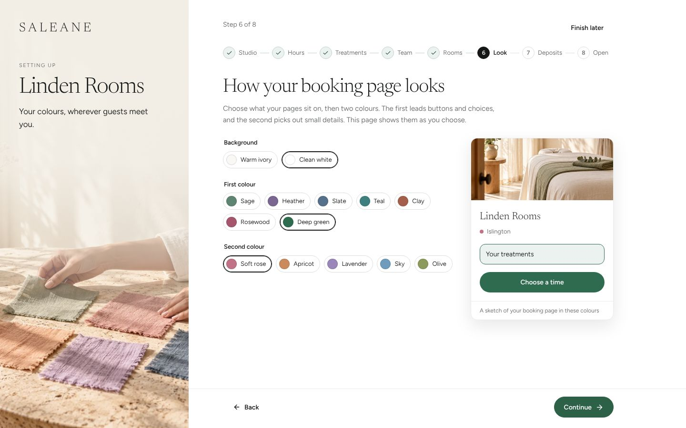        |
| 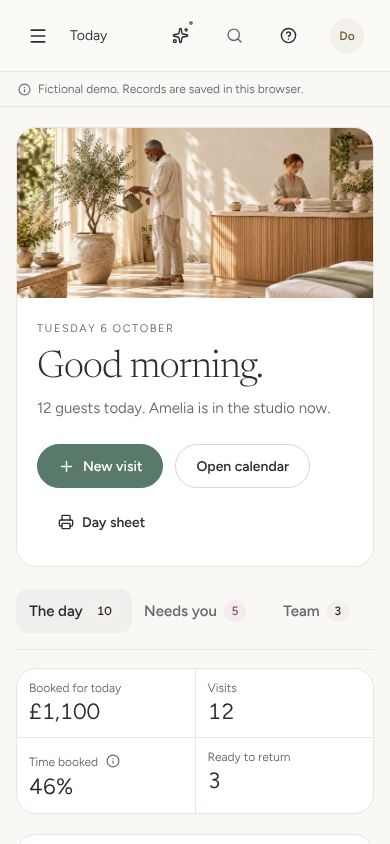          | 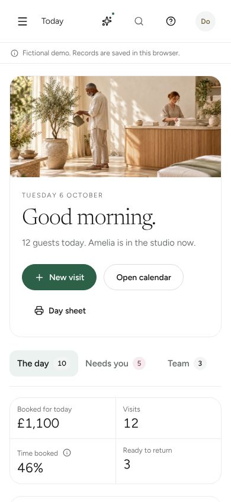          |
| 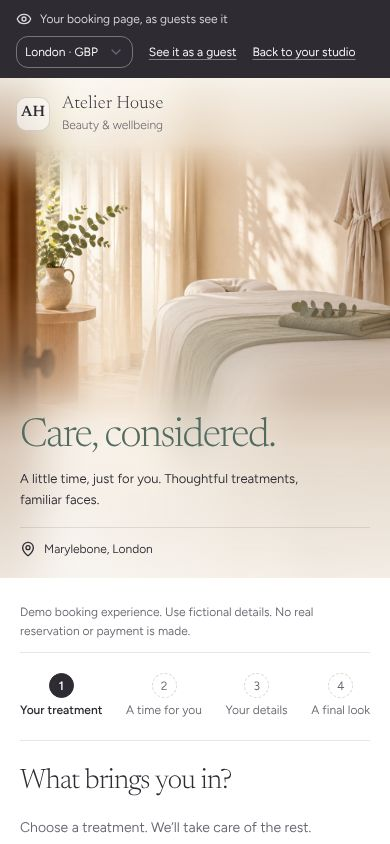 | 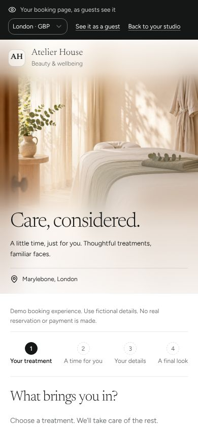 |

## Contrast

- White words on the main button, for every first colour, measure 4.8:1 or more on both backgrounds. Deep green measures 6.98:1 on warm ivory and 7.22:1 on clean white.
- Deep rose words on soft rose measure 4.8:1 or more on both.
- Quieter words (#676c6a) measure 4.98:1 on the cool grey sidebar and 5.34:1 on white.
- A visit email for a clean white studio keeps its button at 4.5:1 or more (checked in `render.test.ts`).

## Tests

- `src/domain/brandRules.test.ts`: a white base is kept with the studio's look; a look with no base is accepted (older studios); an unknown base such as "black" is refused.
- `src/domain/setupScreens.test.ts`: on the Look screen, choosing warm ivory when nothing was saved is no change, and choosing clean white is a change saved with the screen.
- `src/state/studioColours.test.ts` (new): clean white puts `data-base="white"` on the page and warm ivory takes it off; a white base kept in this browser is read back, and an unknown one is ignored.
- `src/email/render.test.ts`: a clean white studio's email sits on #f6f7f7 and its button still reads at 4.5:1.
- `server/brandRules.test.ts`: a white look saved by the owner reaches the public booking payload, so guests see it.

## Browser journey

1. Demo, 1440px: Settings, Booking page & colours. Choosing Clean white turns every page white at once and puts `data-base="white"` on the page; choosing Deep green re-tints buttons and choices. Today, Calendar, the booking page, Clients, Inbox and Money were each opened and look right, with no warm strips left behind: no stylesheet or screen writes the ivory itself outside the design tokens (the swatch and the email palette name it on purpose).
2. Demo, 390px: the same pages, nothing scrolls sideways. In Settings the look's choices were 36px tall on a phone, on main too; they now reach 44px on phones and touch screens like every other choice (115 by 44px and 119 by 44px for the two backgrounds), and keep 36px with a mouse.
3. Warm ivory against main: the booking page matches main pixel for pixel; the calendar differs by 293 pixels, all in the now line, which moves with the clock.
4. Fresh studio (signed up without the sample), 1440px and 390px: on Set up your studio, the Look screen shows Background above the two colours. Choosing Clean white and Deep green previews them across the whole page; Continue saves them, the next screen and Today stay white, and choosing Warm ivory in Settings puts the original look back. At 390px the page is 390px wide (nothing sideways) and each Background choice is 44px tall; at 1440px they are 36px, the same as the colour choices beside them.

Not checked: Safari and Firefox, a real email app, and a guest's private visit page in a browser (it reads the same saved look as the booking page, through the same guest schema).
