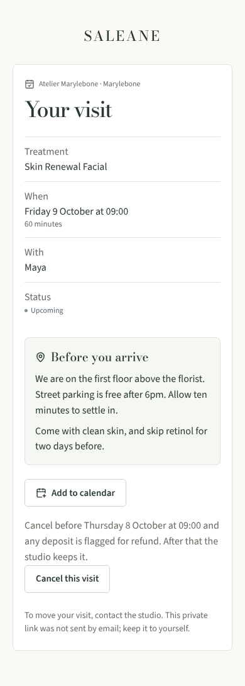
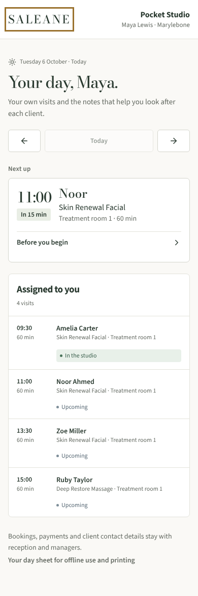
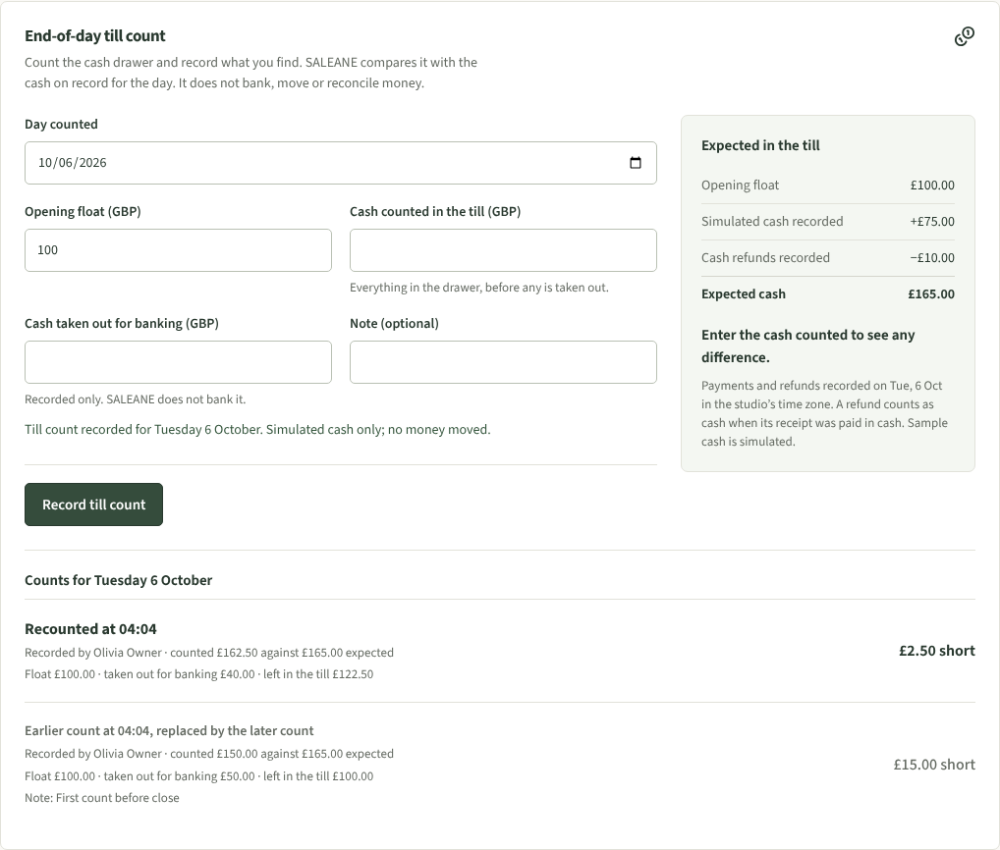
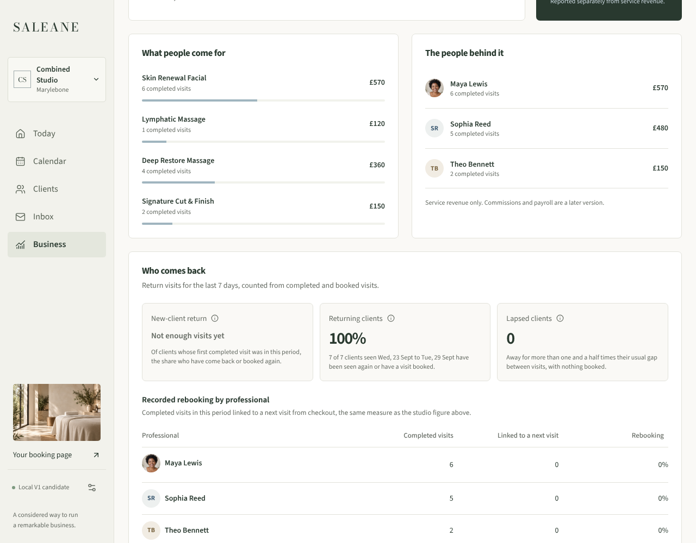

# Small extras evidence

Recorded 7 October 2026. The owner approved these from the field report ("yes to everything"). Local only; no live service is configured. Environment: Linux cloud container, Node 22.22.0, Chromium (Playwright), built host on a throwaway database.

## What was built

| Extra                    | Where                                           | Key rules                                                                                                                                                                                                               |
| ------------------------ | ----------------------------------------------- | ----------------------------------------------------------------------------------------------------------------------------------------------------------------------------------------------------------------------- |
| Who comes back           | Business page                                   | New-client return, returning clients, lapsed count and rebooking per professional. Each figure states its definition; an empty group reads "Not enough visits yet", never 0%.                                           |
| End-of-day till count    | Money page                                      | Float, cash counted, cash taken out for banking, note. Expected cash from recorded cash payments and cash refunds for the studio's day. Append-only; a recount keeps the earlier count. Owner, manager, reception only. |
| All-in price sentence    | Both booking pages                              | Full mandatory price first (including any tax added at checkout), length, deposit. Sample studios say "simulated deposit".                                                                                              |
| Before you arrive        | Booking confirmations and the guest manage page | Studio arrival note and per-service preparation note, 400 characters each, set in Manage studio. Shown only for a confirmed visit.                                                                                      |
| Add to calendar          | Booking confirmations and the guest manage page | RFC 5545 file built in the browser; UTC times from the studio time zone; stable hashed UID; no manage token, record id or notes in the file.                                                                            |
| Share your booking page  | Manage studio, owner and manager                | Plain, Google and Instagram links. `?from=google` or `?from=instagram` is recorded on the visit as its channel; unknown values are ignored.                                                                             |
| Practitioner pocket view | The practitioner's own day                      | "Next up" card on today, day buttons, and "Before you begin" with Good to remember and the last completed visit with this practitioner. One projection field added (`previousVisit`: date and treatment name only).     |

## Checks

- Lint, format and type checks clean. 246 app and domain tests and 92 server tests pass (2 measurement tests skipped as before). New server tests cover till count roles and retries, the GuestView key list, and the practitioner projection staying within LOCAL-01 scope (own visits only, cross-studio and revoked membership denied).
- `scripts/qualify.mjs` on the combined build: 63 page checks at 1280px, 390px and 320px with 0 axe violations, no horizontal scroll and no focus gaps; 10 dialogs clean; the keyboard daily loop passes in both modes.
- Journeys exercised in Chromium: owner saves arrival notes and copies the Google link; a guest books through `?from=google`, sees the card and downloads the calendar file; the manage link shows the same card and file; demo booking through `?from=instagram`; a US studio shows tax inside the headline price; owner and reception record till counts and a recount; a practitioner sees Next up, opens Before you begin, welcomes a client and saves a note at 390px and 320px.
- Fixed while combining: on the server booking page the service text was right-aligned by an older shared rule. It now reads from the left like the demo page.

## Not covered

- Safari, Firefox and real phones; screen-reader listening tests.
- No report yet counts bookings by channel (Google or Instagram).
- On a phone, the practitioner's first visit is still marked selected for screen readers while the brief is closed.
