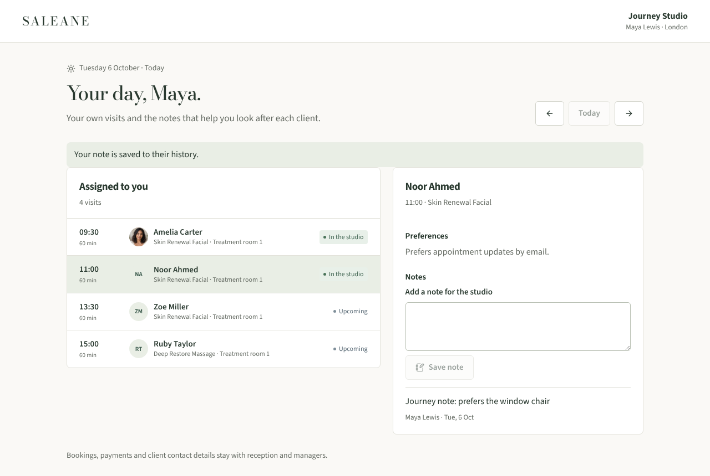
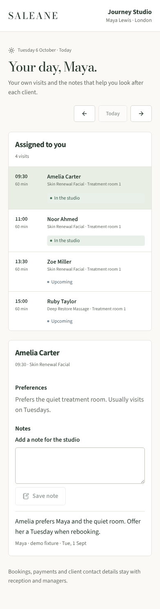

# LOCAL-01 evidence · assigned-practitioner access

Recorded 6 October 2026 on branch `claude/project-thread-b78jfa-local-01`. Local only; no live service configured.

## Automated checks

`npm run check` passed: lint, strict TypeScript, application/server/backup builds and 182 tests (137 frontend/domain/store, 45 server). `npm run format:check` passed on tracked files.

Server tests in `server/practitioner.test.ts` and `server/projections.test.ts` cover:

- Practitioner invitations need one active professional; unknown professionals are refused; a second account cannot link to the same professional.
- The practitioner read contains only their own visits; other visit ids, other clients, client emails, phone, consent, sales, payments, prices and deposits are absent.
- Welcome and note succeed on their own visit and client; welcome on another professional's visit, a note for an unserved client, checkout, consent change and cancellation return 403 and leave the studio revision unchanged. A stale revision returns 409.
- Team, audit, invitations and message sending return 403; another studio returns 404.
- A replayed receipt returns the same result; changing to reception gives the studio view; relinking to another professional changes the scope; removal returns 404, including for a replayed key.

Frontend tests in `src/pages/PractitionerDay.test.tsx` cover the scoped list with no prices or contact details, retry with the same idempotency key after an uncertain save, a reload on a revision conflict that keeps the typed note, and routing a non-practitioner record to the studio workspace.

## Browser journey (Chromium, local dev server)

1. Owner registered a sample studio through the API and invited a practitioner linked to Maya Lewis.
2. The invitation link opened account creation; sign-up routed to `/practice/:studio` showing "Your day, Maya." with four assigned visits.
3. No currency amounts or client email addresses appeared in the page text.
4. Welcoming Noor Ahmed changed the visit to "In the studio"; a note was saved and appeared in the client's history.
5. The owner's studio record contained the practitioner's note.
6. Desktop (1280px) and mobile (390px) were captured with no page errors.

## Not covered

No Safari/Firefox run, screen-reader sampling or load measurement. Practitioners cannot book, reschedule, check out or see their own takings; those are later scope decisions, not omissions hidden by the UI.
