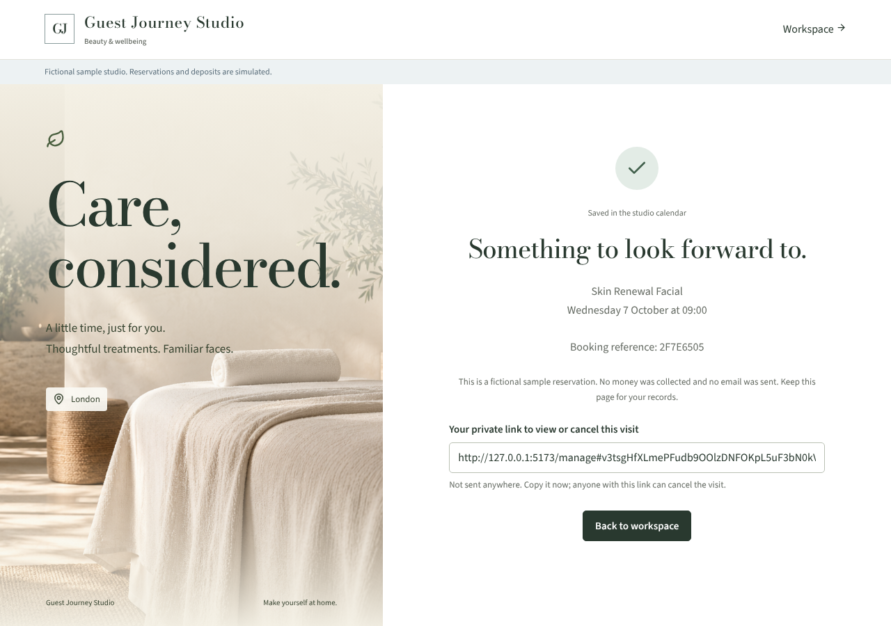
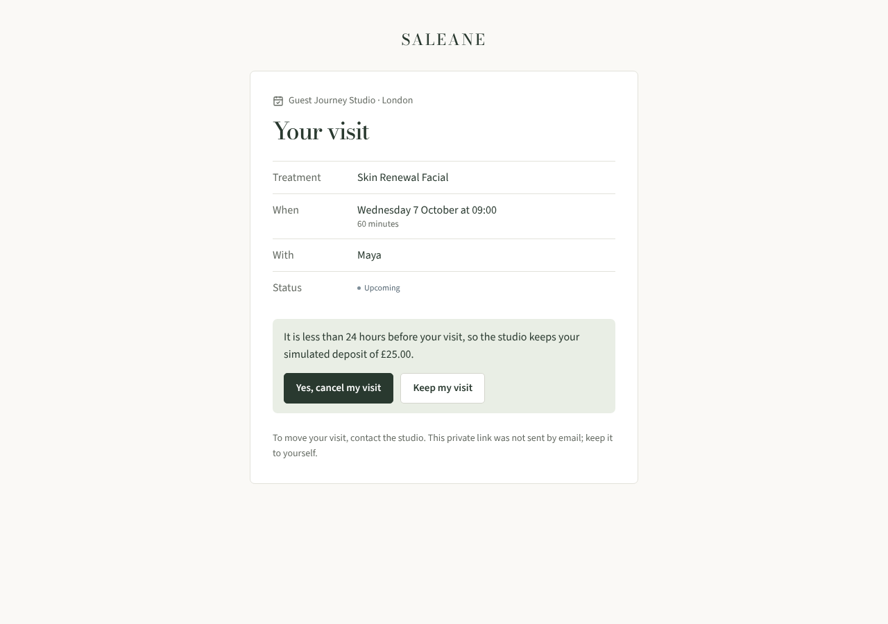
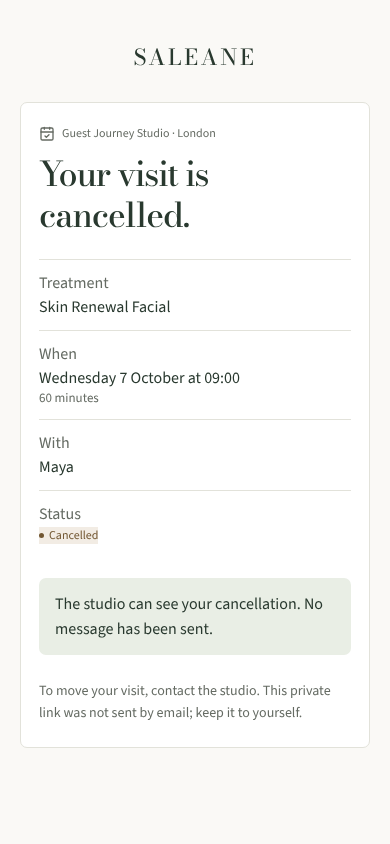

# LOCAL-02 evidence · guest manage and cancel

Recorded 6 October 2026 on branch `claude/project-thread-b78jfa`. Local only; nothing is emailed and no payment provider is configured.

Policy chosen by the user: a guest cancelling at least 24 hours before the visit has any paid deposit flagged for refund; later, the studio keeps it. No refund is made automatically.

## Automated checks

`npm run check` passed: lint, strict TypeScript, application/server/backup builds and 206 tests (141 frontend/domain/store, 65 server). `npm run format:check` passed on tracked files.

`server/guest.test.ts` covers:

- A booking returns a `/manage#token` link marked `not_sent`; only a hash is stored; the visit view contains no client name, email, phone, client id or appointment id; an unknown token returns the same 404 as every other failure.
- Cancelling before the cutoff with the terms the guest saw marks the visit cancelled, records who cancelled and that the deposit is flagged for refund, leaves the payments ledger unchanged and writes one audit event. A request with stale terms gets 409. A repeat returns the same result without a second change.
- Inside 24 hours the deposit is retained. Once the visit has started, cancellation is refused; seven days later the link stops opening.
- The desk can reissue (older links stop) or stop all links; another studio gets 404 and a practitioner gets 403.
- A replayed booking confirmation gets a fresh link and the earlier one stops. A desk reschedule shows the new time on the same link; a desk cancellation shows the visit as cancelled.

`src/pages/ManageVisit.test.tsx` covers the confirmation step sending the terms the guest saw, reloading when those terms changed, and a link with no token never calling the server.

## Browser journey (Chromium, local dev server)

1. Owner created a sample studio. A guest booked the first time on offer through `/book/:studio` and the confirmation showed the private link, labelled as not sent.
2. The link opened the visit with no email or phone on the page.
3. The visit was less than 24 hours away, so the confirmation said the simulated £25.00 deposit would be kept. The guest cancelled.
4. The studio record showed "Cancelled online by the guest. Deposit of £25.00 retained under the 24-hour cancellation policy." from "Guest (private link)".
5. The desk created a link for another visit (201, `not_sent`). A made-up token showed the invalid-link message. No page errors; checked at 1280px and 390px.

## Not covered

The refund-due path was exercised by API and component tests, not in the browser run. Guests cannot move a visit online. Links are bearer capabilities: anyone holding one can cancel that visit, and there is no verified identity without an email provider. No Safari or Firefox run.
