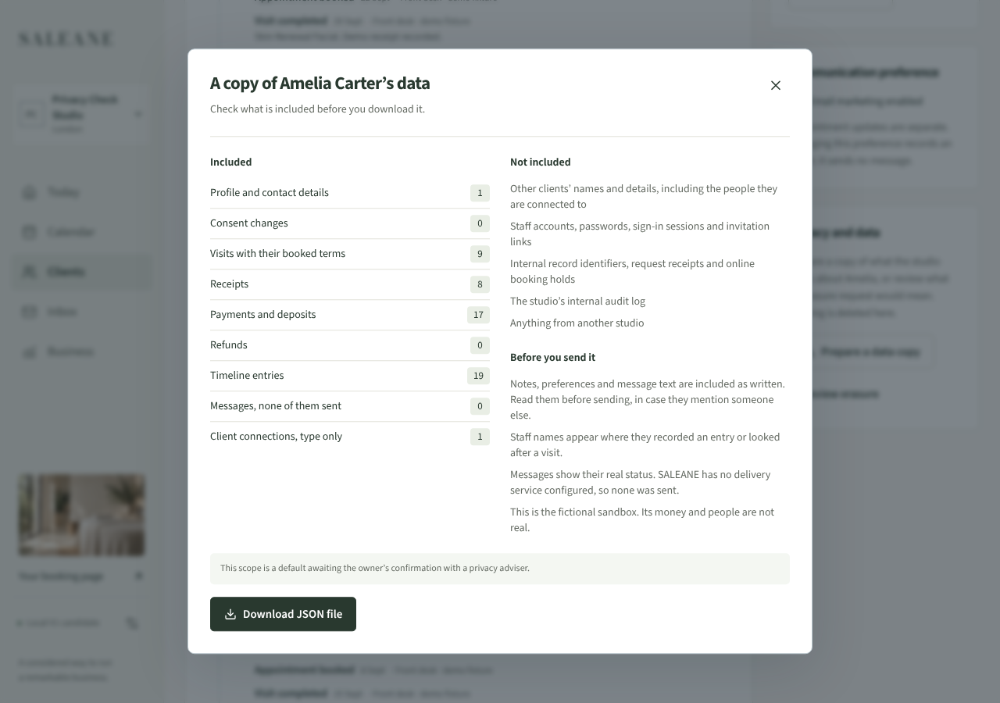
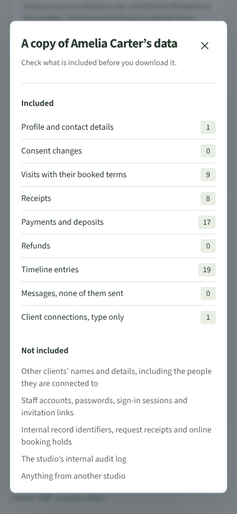

# LOCAL-03 evidence · privacy and data lifecycle

Recorded 6 October 2026 on branch `claude/project-thread-lszoe0-privacy`. Local only; no live service configured. Scope, roles and retention are defaults awaiting the owner's decision (see [PRIVACY.md](../PRIVACY.md)).

## Automated checks

`npm run check` passed: lint, strict TypeScript, application/server/backup builds and 230 tests (161 frontend/domain/store, 69 server). `npm run format:check` passed.

New tests:

- `src/domain/privacy.test.ts` (9): role table; client export includes profile, visits, receipts, payments, refunds and timeline with V1… references; no other client's name, email or phone and no internal ids (`clientId`, `organisationId`, record ids); connections are type only and relationship entries are reworded; messages say "not sent"; preview counts, exclusions and the free-text warning; unknown client refused; studio export has the team and no password, hash, token, csrf or session text; erasure review leaves state unchanged and lists kept money records with reasons and the upcoming visit.
- `server/privacy.test.ts` (9): owner and manager preview and export, with one `client.exported` audit row per download and none per preview; audit rows hold no client names or phone numbers; reception and practitioner get 403 on every privacy endpoint, for real and missing clients alike; another studio gets 404 and its own export holds only its own organisation; a removed manager gets 404 and an unsigned request 401; a missing CSRF token gets 403; the studio export is owner only and excludes password hashes, a live invitation token and a live hold token; recording an erasure request returns `deleted: 0`, leaves the studio record identical, refuses a duplicate (409) and writes `client.erasure_requested`; unknown body fields are refused.
- `src/components/Privacy.test.tsx` (2): browser demo preview then download, readable summary, "keeps no audit log" status; erasure review leaves demo storage unchanged.

## Browser journey (Chromium, built standalone server on 127.0.0.1:5187, throwaway database)

Recorded in [LOCAL-03-browser.json](LOCAL-03-browser.json).

1. Owner registered a sample studio. On Amelia Carter's page, "Prepare a data copy" showed included counts, exclusions and notes before any download.
2. Download produced `amelia-carter-data.json` for Amelia only, with no other client names, `client-2`, `organisationId`, password or token text, then the readable summary `.txt`.
3. "Review erasure" listed removable and kept records; "Record erasure request" showed "Nothing has been deleted" and the client panel then showed the recorded request.
4. Manage studio → Data & privacy: preview, then the studio download (15 clients, no password/token/csrf/hash text). The privacy record listed the three audited actions.
5. A reception account saw only an explanation on the client page; direct API calls for the client and studio exports returned 403.
6. At 390px the export dialog had no horizontal overflow. No page errors.

## Not checked or not built

- No destructive erasure, anonymisation or automatic retention: decisions are outstanding by design.
- Manager role was exercised by server tests, not in the browser. Practitioner denial is by server tests only.
- The audit log has no general UI; privacy actions are shown in Manage → Data & privacy only.
- Demo mode exports are built in the browser and are not audited (no audit log exists there); erasure requests cannot be recorded in the demo.
- Free text (notes, preferences, messages, refund reasons) may name other people and is exported as written, with a warning.
- No legal review, Safari/Firefox, screen-reader or large-studio size testing of the export.
