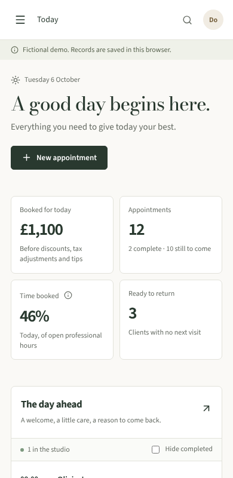

# LOCAL-05 evidence · qualification pass

Recorded 6 October 2026 on branch `claude/project-thread-lszoe0`. Local only; no live service configured. Environment: Linux cloud container, 4 CPUs, Node 22.22.0, Chromium 141.0.7390.37 (Playwright), built standalone host on `127.0.0.1:5173` with a throwaway database.

## What was checked

`scripts/qualify.mjs` drives the built app in two modes: the browser demo, and a signed-in local sample studio created through the API. Raw results: [LOCAL-05-sweep.json](LOCAL-05-sweep.json).

- **Automated accessibility rules:** axe-core 4.14 with WCAG 2.0, 2.1 and 2.2 A/AA plus best-practice rules on 21 routes at 1280px, 390px and 320px (63 page checks), and on five open dialogs per mode (find a client, settings, appointment, new appointment, measure definition).
- **Reflow:** no horizontal scroll at 320px on any route (the WCAG 1.4.10 width that corresponds to 400% zoom of a 1280px window).
- **Keyboard:** on every route at 1280px, each element reached by Tab shows a visible focus indicator. Dialogs keep focus inside while open, close with Escape and return focus to the page.
- **Keyboard-only daily loop**, in both modes: Tab to an upcoming visit, open it, welcome the client, continue to checkout, record the payment, see "Rebook this client", close and land back on the page. All seven steps passed.
- **Structure as exposed to assistive technology:** every route has one `h1`, a page title and a language; landmarks are listed per route in the sweep file.

### Found and fixed

| Finding (first sweep)                                                                                                                                                                                  | Fix                                                                                                                                                       |
| ------------------------------------------------------------------------------------------------------------------------------------------------------------------------------------------------------ | --------------------------------------------------------------------------------------------------------------------------------------------------------- |
| Visit rows on Today and Calendar, and service cards on the demo booking page, had a spoken name that did not contain their visible text (WCAG 2.5.3). Voice control users could not say what they see. | The name now comes from the visible text, with spaces so it reads as "09:30 60 min Noor Ahmed Skin Renewal Facial Maya Upcoming". Tests updated to match. |
| "Find a client" and the operator button had names that did not match their text, and lost their text entirely on phones.                                                                               | Names come from the visible text; on phones the words are hidden visually but still read out.                                                             |
| The "How this is measured" popover had no accessible name.                                                                                                                                             | Named after its measure.                                                                                                                                  |
| The version notice and booking notices sat outside any landmark.                                                                                                                                       | Each is now a labelled section.                                                                                                                           |
| The sign-in page had two `h1` headings.                                                                                                                                                                | The brand line is styled text; the form keeps the one `h1`. Appearance unchanged.                                                                         |

After the fixes: 0 axe violations across all 63 page checks and 10 dialog checks, no overflow, no focus gaps. The only console messages are the expected 401 from checking for a session on the signed-out account page.

## Measured performance and recovery

`server/measure.test.ts` (skipped in `npm test`; run with `MEASURE=1`) inflates a sample studio, then times the local API in process (no network) and a backup, verify and restore drill. Raw results: [LOCAL-05-measure.json](LOCAL-05-measure.json). Times in milliseconds, 20 runs (10 for booking).

| Studio size                  | Studio record | Read p95 | Note save p95 | Desk booking p95 | Public availability p95 | Backup / verify / restore |
| ---------------------------- | ------------- | -------- | ------------- | ---------------- | ----------------------- | ------------------------- |
| 1,074 visits, 415 clients    | 1.1 MB        | 31       | 71            | 77               | 29                      | 31 / 12 / 33              |
| 5,074 visits, 2,015 clients  | 4.8 MB        | 105      | 288           | 297              | 108                     | 126 / 56 / 132            |
| 30,074 visits, 8,015 clients | 26.9 MB       | 568      | 1,503         | 1,702            | 612                     | 646 / 309 / 699           |

The first run found record validation was quadratic: every visit, event and payment was matched by scanning whole lists. At 5,074 visits a read took 322 ms (p95) and a booking 966 ms; at 30,074 visits the run did not finish within 15 minutes. `parseState` now indexes each collection once, with the same rules. The restored database opened at the same revision every time.

Against the PRD targets (reads under 500 ms, booking under 1 s), a studio of about 5,000 visits is comfortably inside. At 30,000 visits reads and bookings are over target, because each request still loads and rewrites the whole studio record. That is the planned move to relational tables with the production database, not something to tune further here.

## Not covered

- **Safari and Firefox:** not run. Downloading Playwright's Firefox and WebKit builds is blocked in this environment, so only Chromium is evidenced. These need a run on a Mac or a machine with those browsers.
- **Screen readers:** no VoiceOver, NVDA or JAWS session. The structure and names above are what Chromium exposes, not a listening test.
- **200% browser zoom** was not set directly; reflow was checked at 320px instead.
- **Real devices:** phone widths were emulated in Chromium; no iOS or Android device.
- Performance was measured in process on a cloud container, not over a network or on studio hardware. No pilot-condition numbers yet.
- The other RC3 work (privacy, schedule history, offline day sheet) is in separate draft PRs; this sweep covers main plus these fixes.
