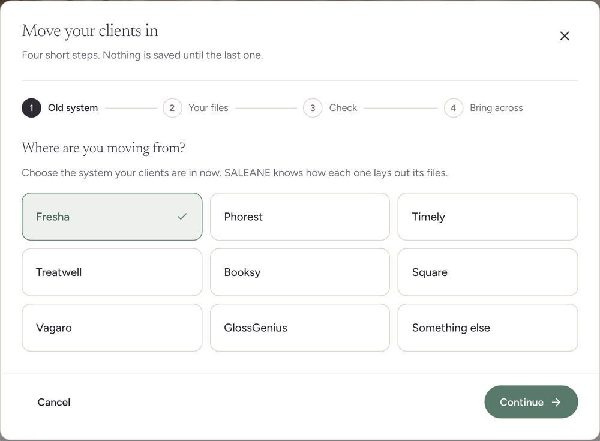
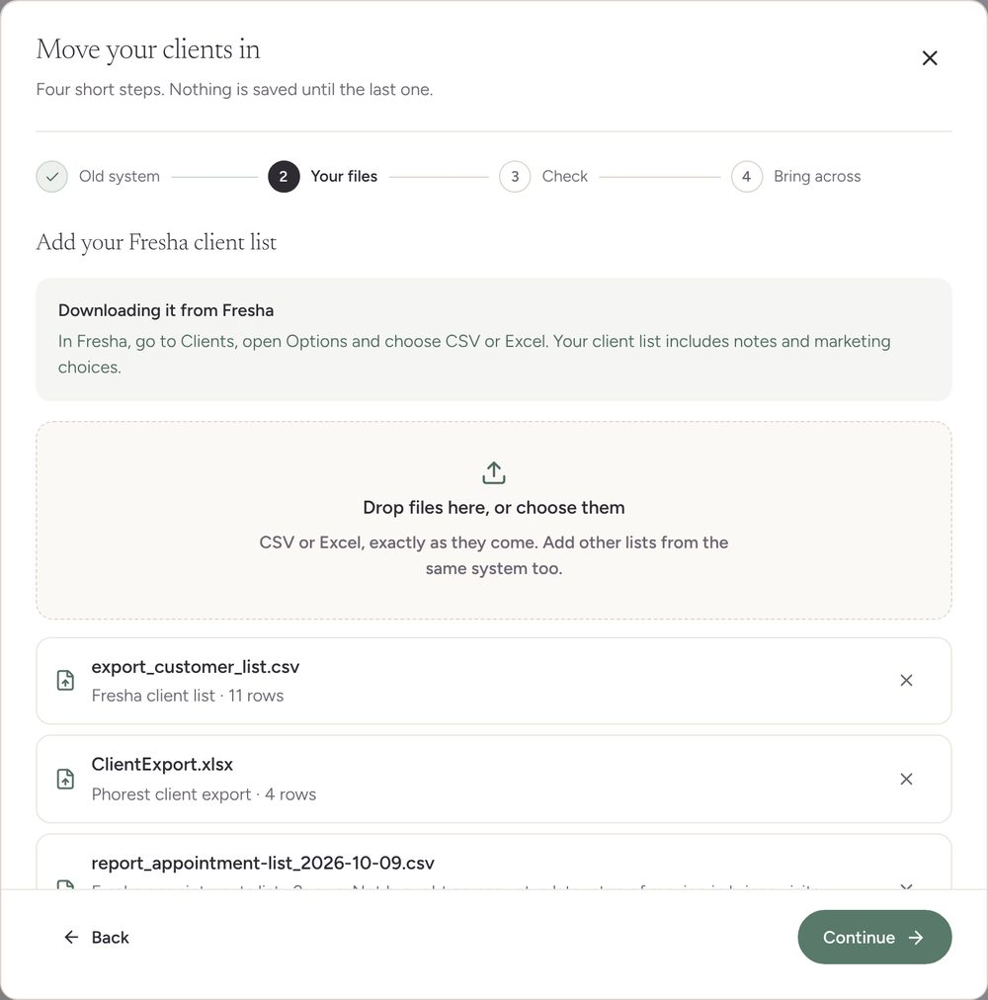
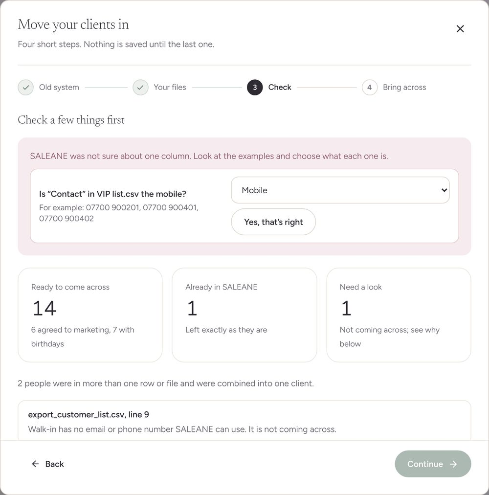
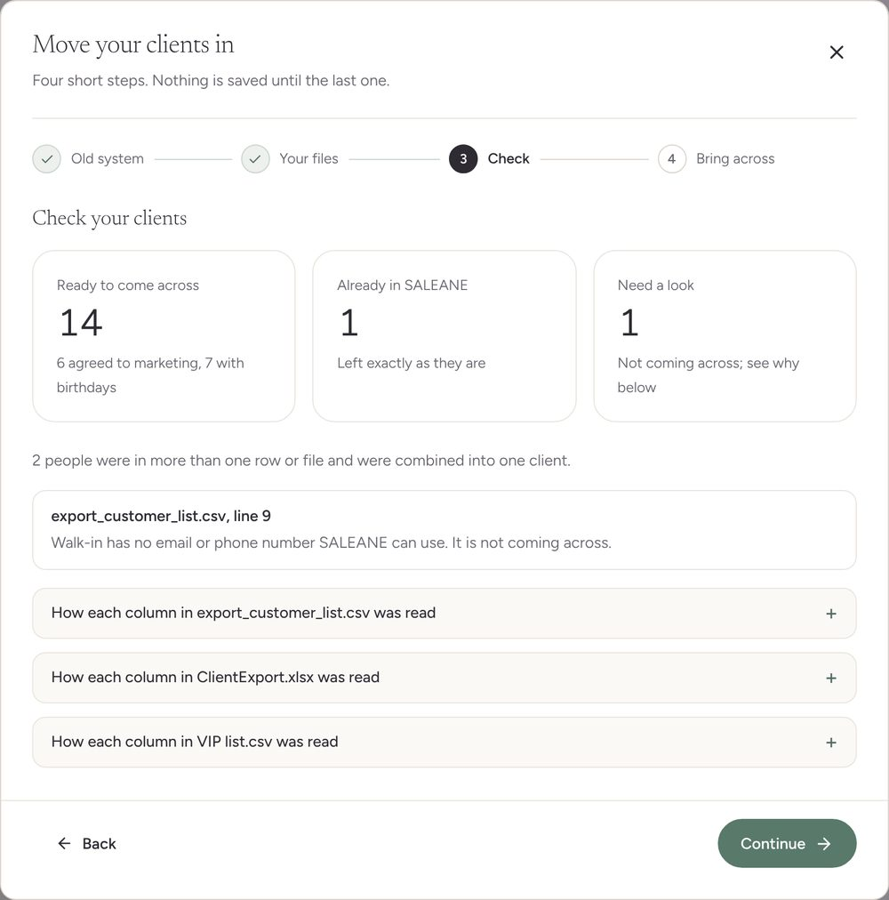
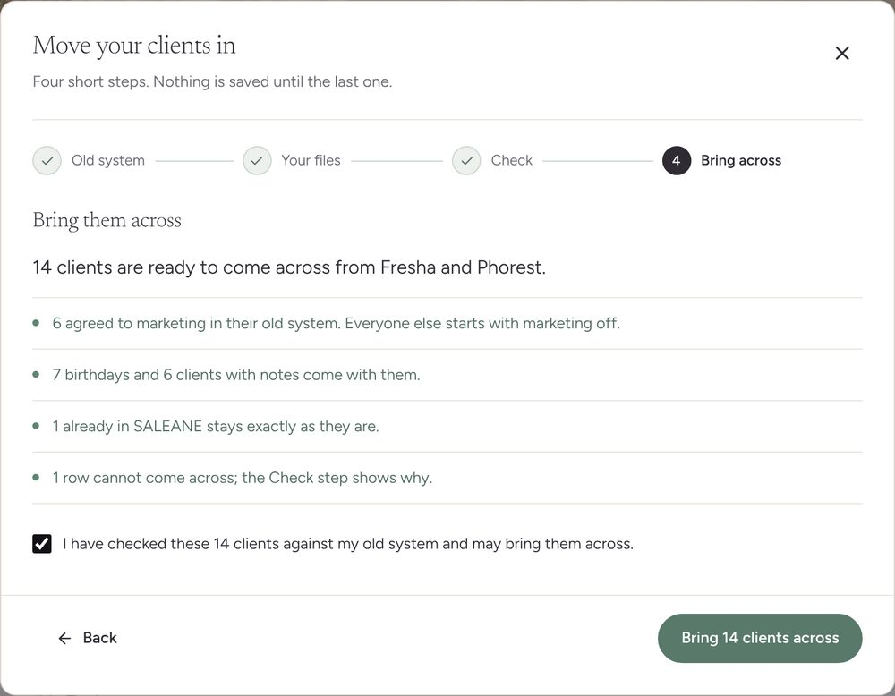
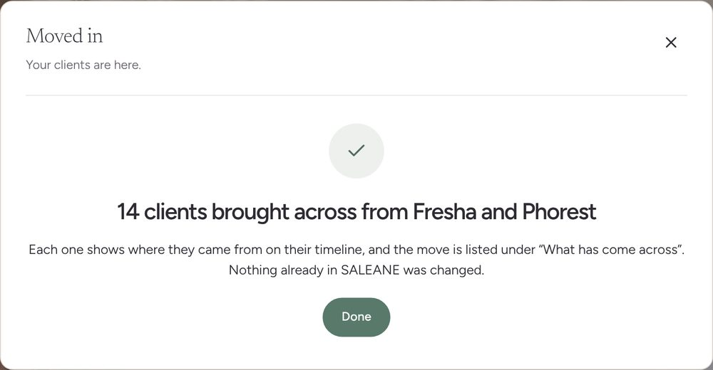
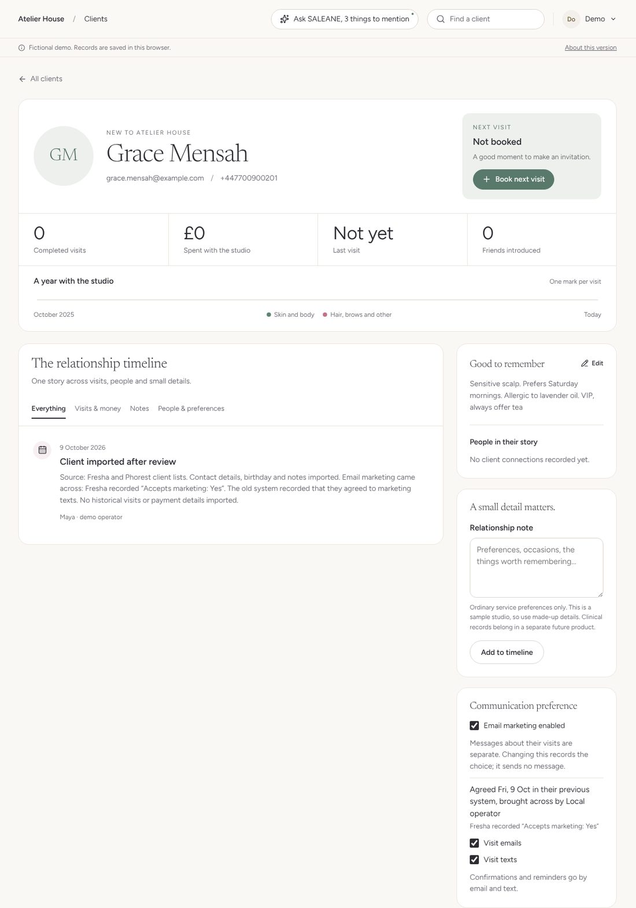
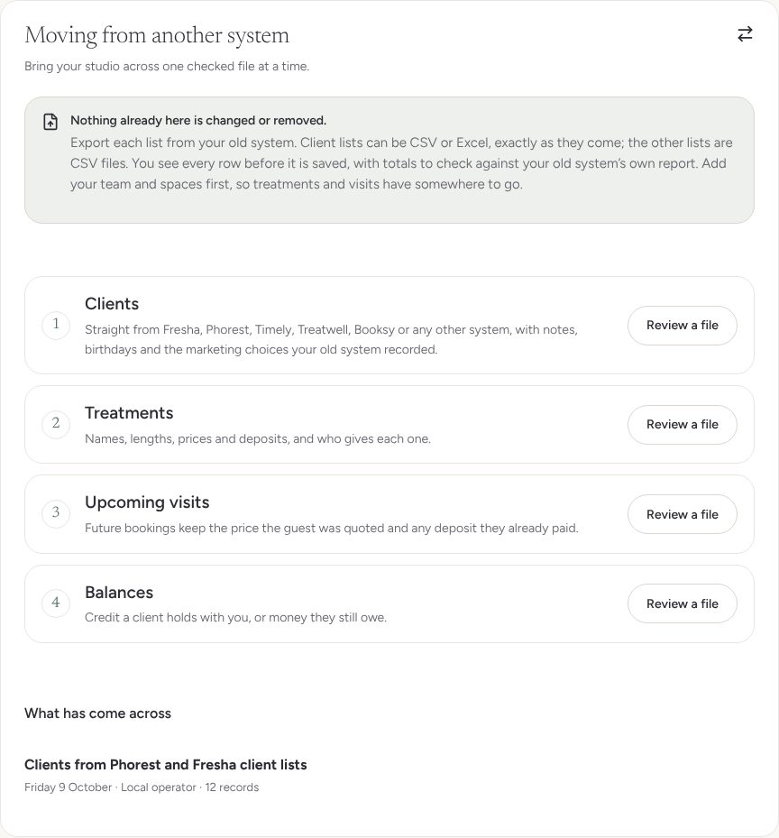
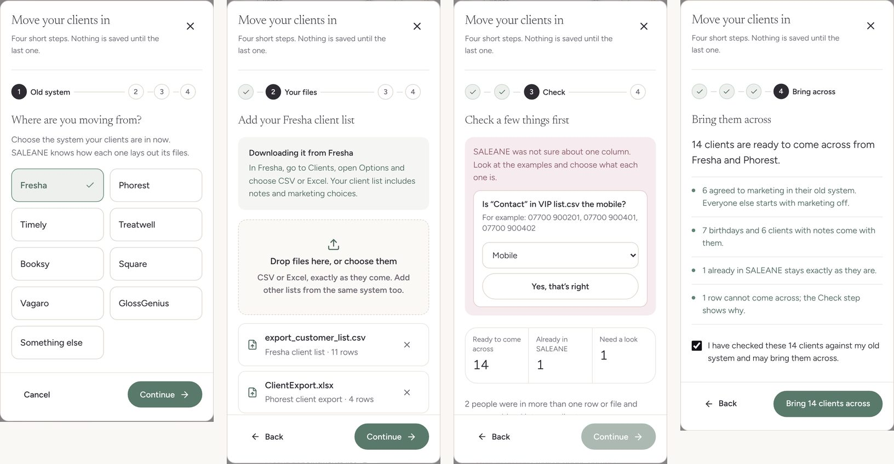

# MOVING-01 · Moving in, stage 1: clients from any system

**Status: built locally on 9 October 2026, awaiting the owner's "merge"; nothing deployed.**

The owner said yes to all five moving-in answers on 9 October 2026: the UK five first (Fresha, Phorest, Timely, Treatwell, Booksy), a free "move me in" service, marketing only where the old system shows the client agreed, cards saved again through a link, and start building now. This is the first stage: the client list.

## What the owner sees

Clients, Import clients, and Settings, Switching over, Clients, now open the same screen, "Move your clients in": four short steps, named along the top, with finished steps ticked. Nothing is saved until the last one. Back and Continue stay at the bottom of the window however long a step is, Continue waits until a step is complete, and each new step starts at the top with its heading read out to a screen reader. On the owner's first try this was one long page; after "is it good enough? should it be a kind of wizard and should it be cleaner" it became these four steps, with the same reading and saving underneath.

1. **Old system.** "Where are you moving from?" Nine large tiles: the UK five first, then Square, Vagaro, GlossGenius and "Something else".
2. **Your files.** "Add your Fresha client list", with where to find the export in that system, in plain words, then the drop area. Drop or choose as many files as they like, CSV or Excel (.xlsx), exactly as the old system gave them. Each file is named with what SALEANE thinks it is ("Fresha client list · 11 rows", "Phorest client export · 4 rows"). Visit, gift card, package and payment files are recognised and named rather than refused; they are not saved, and the screen says a later step brings them across and the owner adds the file again then. Continue waits until there is a client list.
3. **Check.** Any column SALEANE is unsure of comes first as a question, with three examples from the file ("Is “Contact” in VIP list.csv the mobile?"), and Continue waits for the answer. Below it: ready, already here, and needing a look, with how many agreed to marketing and how many have birthdays; who was combined; each row that cannot come across and why; and, folded away, what every column becomes, which the owner can change.
4. **Bring across.** "14 clients are ready to come across from Fresha and Phorest", then four plain sentences (marketing, birthdays and notes, who stays as they are, rows left out), one tick and "Bring 14 clients across". Long lists go in parts the server accepts, one after another. A dropped connection keeps the files and says how many came across; anyone saved shows as already here on the next review. Going back to an earlier step clears the tick.

## Rules kept

- **Nothing already in SALEANE changes.** Same name plus the same email or phone means "already here" and the row is left out. Nobody is merged on email alone. The server refuses an import containing an existing or repeated client.
- **The same person in several rows or files is combined** into one client, keeping every note.
- **Marketing comes across only with evidence.** A client's email marketing is on only when the old file records that they agreed in an email or general marketing column ("Accepts marketing: Yes", "emailMarketingConsent: true", "Subscribed"). "Unknown", blank or anything unclear means off. The consent record has source "previous system", the evidence in the old system's own words, and no wording version, because SALEANE never showed them its own words. The server refuses carried consent without evidence. Text marketing is noted on the timeline but not switched on. A client with no email starts with email marketing off, with a note saying why.
- **Clients without an email can come across** when they have a phone number. Guest booking and new clients at the desk still need an email. Editing a client never removes an email they already had.
- **Phone numbers become international** for the studio's country: "07700 900123", "7700900123" (Excel dropped the zero), "+44 (0)20…", "0044…" and US 10 or 11 digit numbers.
- **Birthdays keep month and day only**, read in the file's own date order. Names written in capitals or surname first are tidied.
- **Card details never move across.** A card column is left out with "Clients save their card again through a link."

## The client afterwards

Grace Mensah appeared in the Fresha list twice and in a VIP spreadsheet. She arrived once, with all three notes, her birthday, and email marketing on. The client page says "Agreed Fri, 9 Oct in their previous system, brought across by Local operator" with "Fresha recorded “Accepts marketing: Yes”" beneath it. Her timeline lists the source and what came across. Her privacy file says "agreed in their previous system: Fresha recorded “Accepts marketing: Yes”"; a client with no email reads "Email: Not recorded".

The move is listed under Settings, Switching over, What has come across ("Clients from Phorest and Fresha client lists").

## How it was checked

- `npm run check` (lint, all tests, build) and `npm run format:check` pass.
- 23 domain tests in `src/domain/movingIn/movingIn.test.ts`: comma, semicolon and tab files, a byte-order mark, Windows text and UTF-16; an Excel workbook with dates stored as numbers; files it cannot read (.xls, a web page saved as .xls) explained; synonyms; headings checked against contents; title and totals rows; the layouts for Fresha, Phorest, Timely, Square, Vagaro and GlossGenius; visits and gift card files told apart; phones, birthdays and names; a Fresha list end to end, including the saved studio read back and moved again (everyone already here); consent refused without evidence; a client already here left untouched; a household sharing one email, here and in the files; rows for one person that only meet once every detail is known; two files combined; marketing off for a client with no email; a US Square export; long lists split into parts; editing a client without an email; the privacy file wording.
- Three interaction tests on the Clients page: the four steps walked with a Fresha list (Continue held until a system and a client list are chosen, focus on each new step's heading), bringing it across with notes, birthday and recorded marketing; more than 20 files chosen at once says so; a failed save keeps the files, clears the tick, and works after going back and forward again.
- Chromium at 1440 by 900 and 390 by 844 pixels on the browser demo, every step walked including Back (which clears the tick), Continue held while a question is open, each step starting at the top, Back and Continue in view at the bottom of a long check, and no sideways scrolling. Four files at once: a Fresha client list (11 rows, with a duplicate, a client already here, a dropped leading zero, a name in capitals, "Unknown" marketing and a row with no contact details), a Phorest client export in Excel with a title row and real Excel dates, a Fresha appointments list, and a hand-made VIP spreadsheet. Result: 14 ready, 1 already here, 1 needing a look, 2 combined, 6 with marketing, 7 with birthdays; 14 clients saved.

## Not done yet, said plainly

- **No real export files yet.** Fresha's client list marketing columns, Square, Vagaro and GlossGenius are confirmed from published sources; Phorest and Timely layouts are likely, from their report labels and API names. Treatwell and Booksy have no published headings, so their files are read by meaning, and an unsure column is asked about. Real files will confirm or correct this.
- **Answers are not remembered** for the next studio from the same system yet.
- **Only clients come across in this stage.** Visit, gift card, voucher, package and balance files are recognised but not saved; the older CSV steps for treatments, upcoming visits and balances are unchanged.
- **Old .xls files** are not read; the owner is asked to save as .xlsx or CSV. Only the first sheet of a workbook is read.
- The free "move me in" service, a practice move, moving day and the US systems are later stages.
- Checked in Chromium only, not Safari or Firefox.
