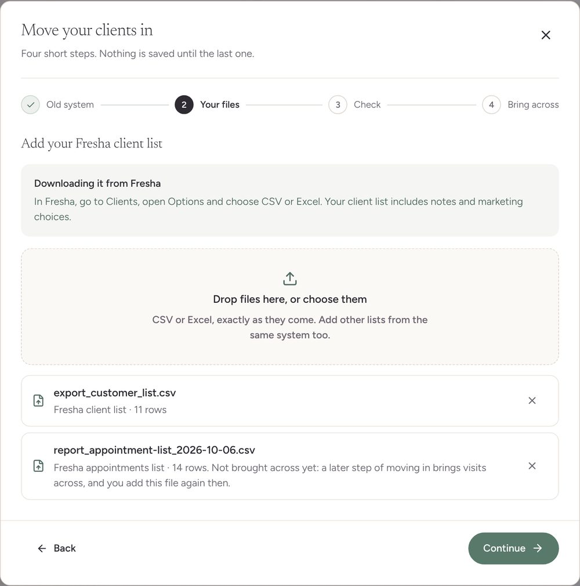
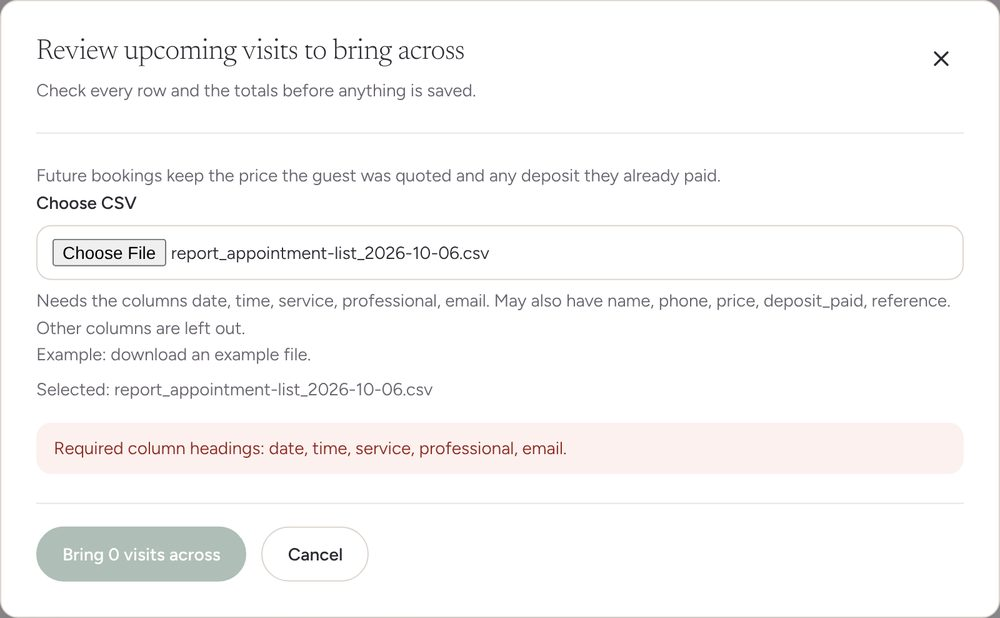
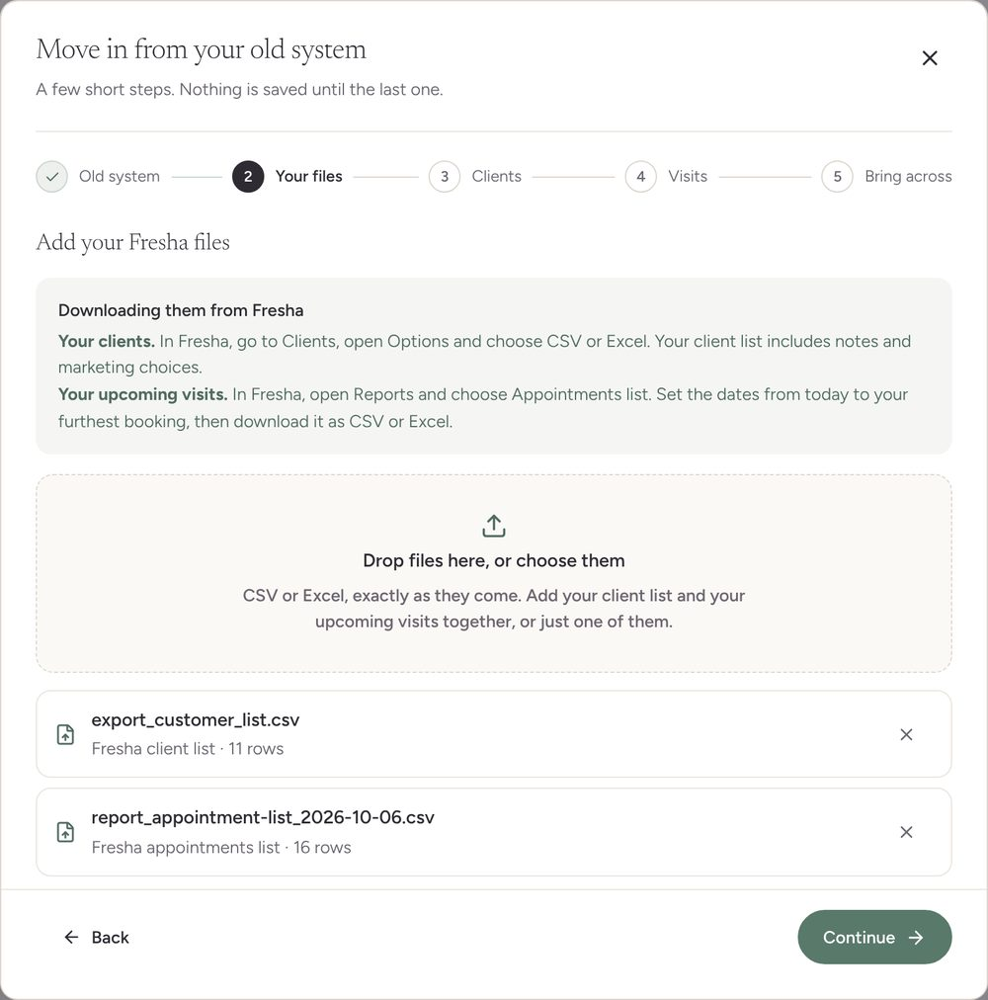
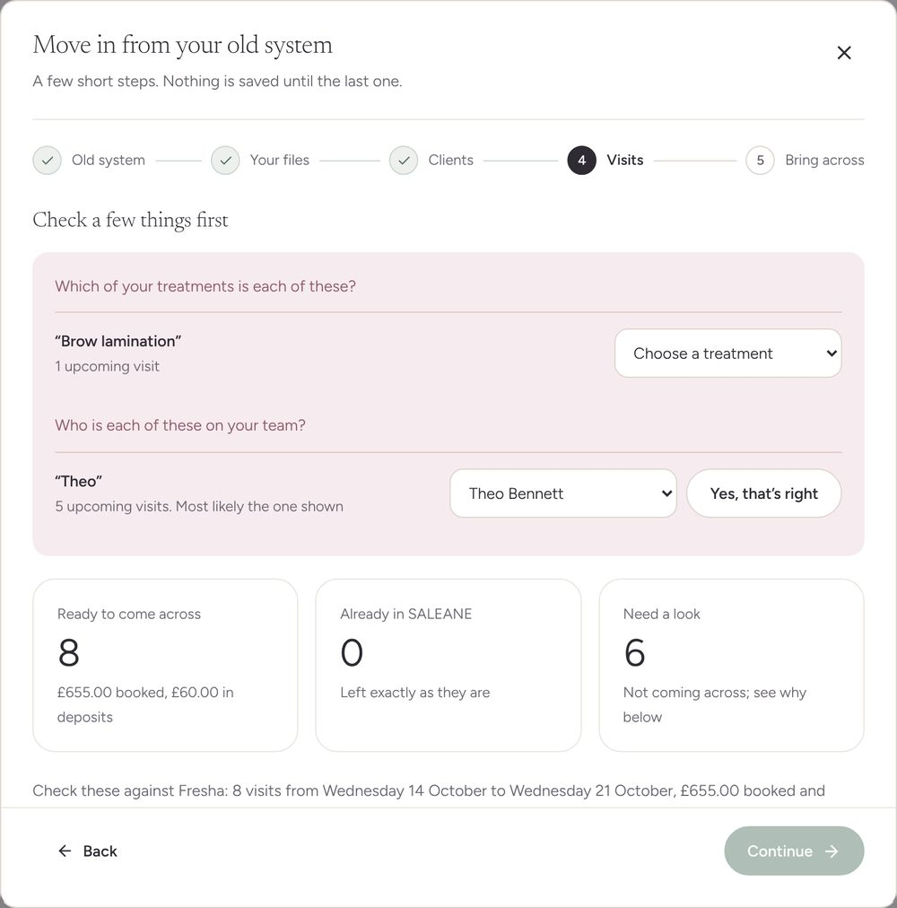
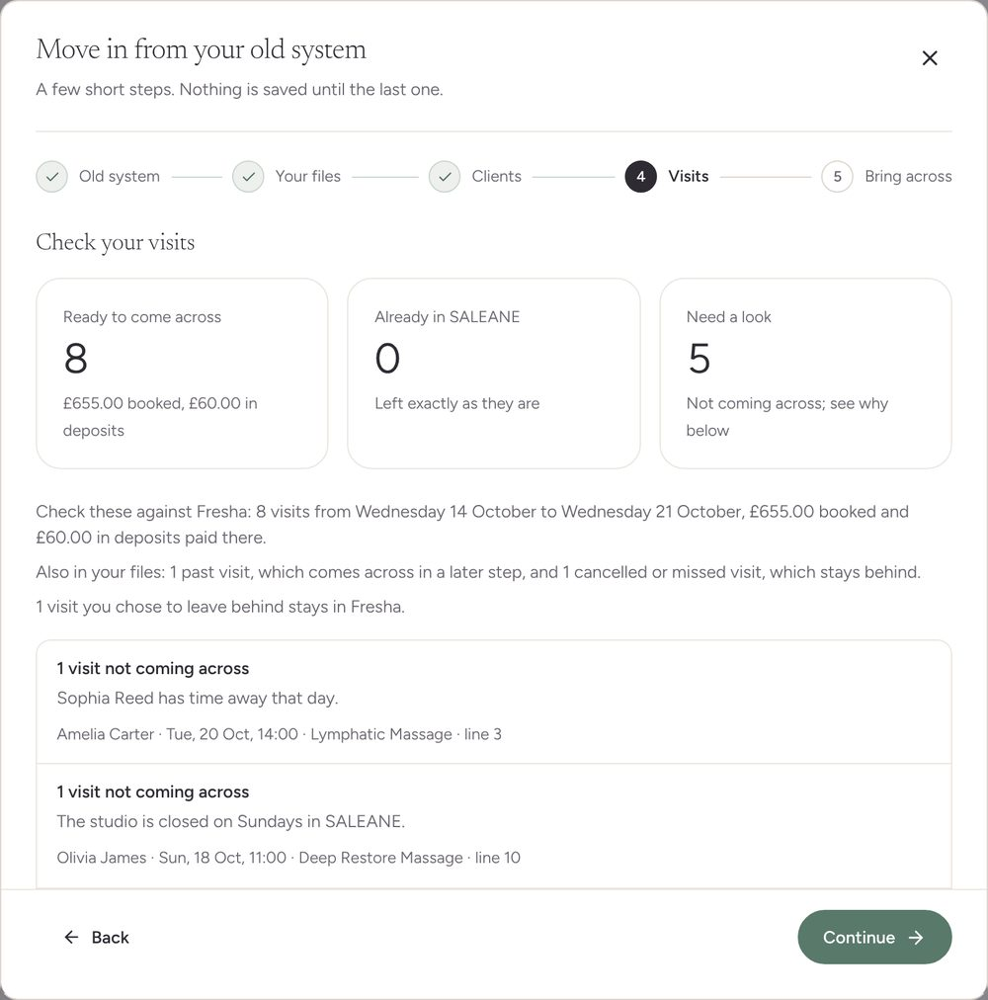
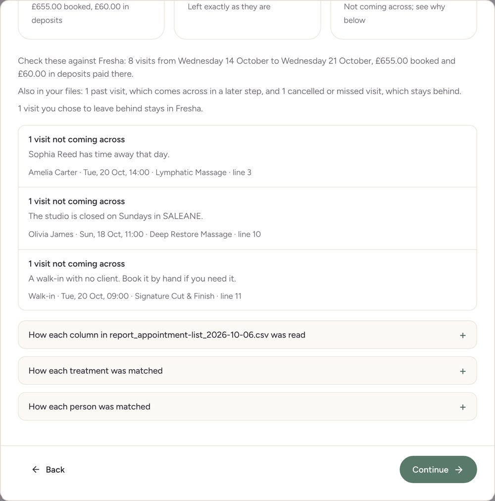
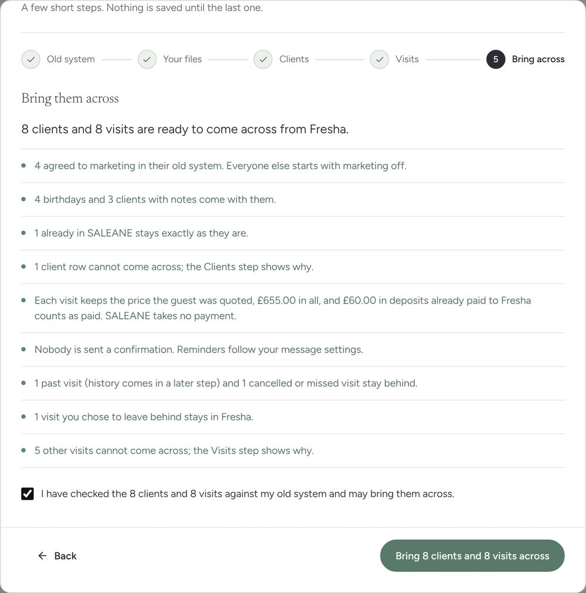
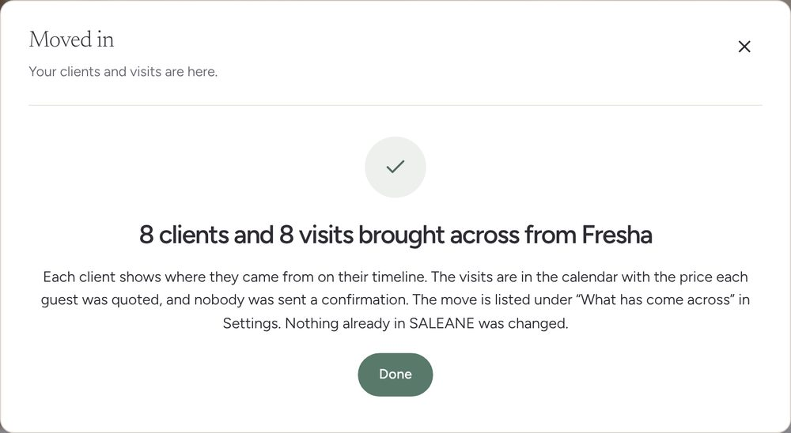
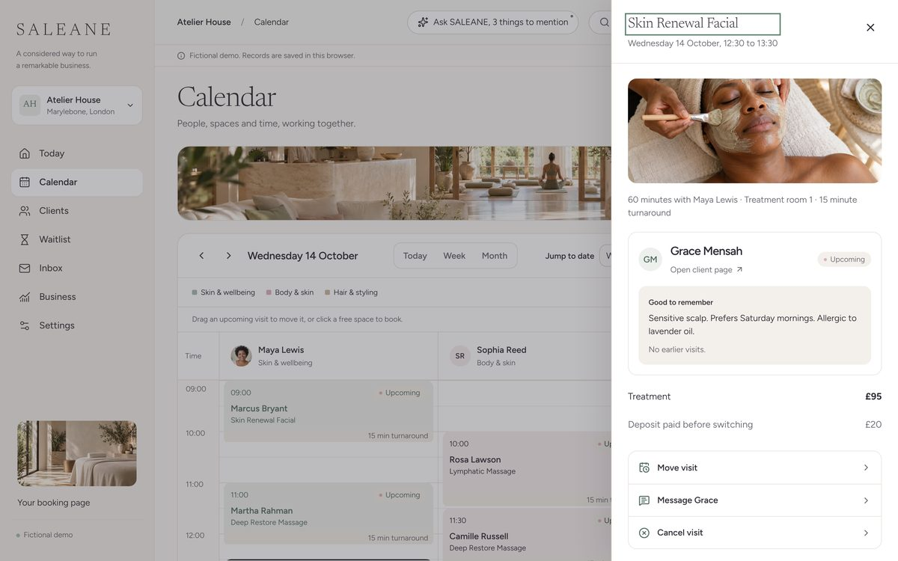
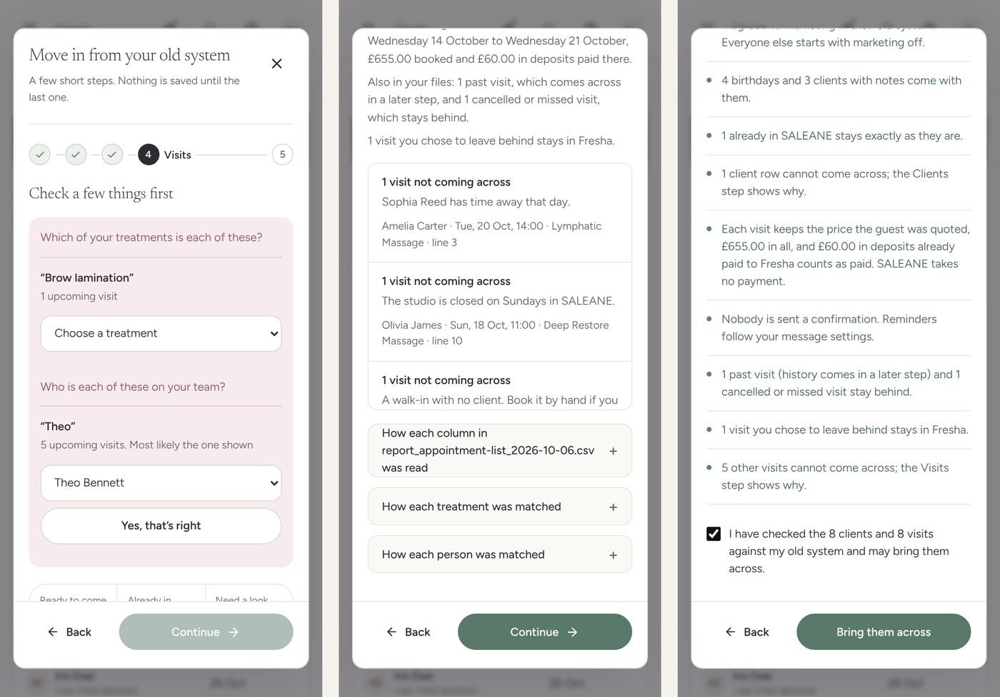

# MOVING-02 · Moving in, stage 2: upcoming visits from the old system's own files

**Status: built locally on 10 October 2026, awaiting the owner's "merge" together with stage 1; nothing deployed.**

Stage 1 brought the client list across. This stage brings the upcoming visits across from the file the old system already gives, such as Fresha's appointments list, in the same steps and at the same time as the clients.

## Before and after

Before, a Fresha appointments list added to moving in was named and then set aside ("Not brought across yet"), and Settings, Switching over, Upcoming visits refused it: "Required column headings: date, time, service, professional, email." The owner had to rebuild the file in SALEANE's own layout, by hand, with every guest's email.

After, the same file is read as it comes.

## What the owner sees

Clients, Import clients, and Settings, Switching over (Clients or Upcoming visits), open the same screen, "Move in from your old system". The steps follow the files: a client list adds a Clients step, a visits file adds a Visits step, and both add both.

1. **Old system.** As before.
2. **Your files.** "Add your Fresha files", with where to find both downloads in that system: the client list, and the upcoming visits ("In Fresha, open Reports and choose Appointments list. Set the dates from today to your furthest booking, then download it as CSV or Excel."). Each file is named with what SALEANE thinks it is ("Fresha appointments list · 16 rows").
3. **Clients.** As before.
4. **Visits.** Anything SALEANE is unsure of comes first: a treatment it cannot match ("Brow lamination") to choose from the studio's treatments or leave behind, and a likely person ("Theo", most likely Theo Bennett) to confirm with "Yes, that’s right". Continue waits for the answers. Below: ready, already here and needing a look, with the booked value and deposits; totals to hold up against the old system's own report ("Check these against Fresha: 8 visits from Wednesday 14 October to Wednesday 21 October, £655.00 booked and £60.00 in deposits paid there."); what stays behind (past, cancelled or missed, and anything the owner chose to leave); then each reason a visit is not coming across, with up to three of its visits. Folded away: how each column was read, and how each treatment and person was matched, all of which the owner can change.
5. **Bring across.** "8 clients and 8 visits are ready to come across from Fresha", plain sentences on prices, deposits and confirmations, one tick, and "Bring 8 clients and 8 visits across" ("Bring them across" on a phone, where the tick above carries the counts). Clients are saved first, then the visits that belong to them.

## Why a visit stays behind, in plain words

Each reason is checked in the order the booking rules check it, so the owner reads the one that matters:

- "Sophia Reed has time away that day." / "Theo Bennett does not work on Mondays in SALEANE."
- "The studio is closed on Sundays in SALEANE." / "08:45 is outside your opening hours on Wednesdays, 09:00 to 18:00."
- "Maya Lewis already has a visit then." (in SALEANE, or earlier in the same file)
- "Maya Lewis is not set up to give Lymphatic Massage in SALEANE. Turn it on in Team, then check again."
- "A walk-in with no client. Book it by hand if you need it."
- "This client is not in SALEANE or in your client list, and this file has no email or phone to add them by. Book the visit by hand once they are a client."
- "Still a request in Vagaro. Book it by hand if you accept it."
- A file without a column SALEANE needs says which, and where to choose it.

Notes on visits that do come across: the old system's booked length differs from the treatment's length in SALEANE ("Booked for 1 hour in Fresha; Gloss & Tone takes 45 minutes in SALEANE, so the calendar holds 45 minutes."), the file gives no price (the treatment's own price is kept), or a client named only in the visits file comes across as a new client, with marketing off.

## Rules kept

- **Each visit keeps the guest's terms**: the price they were quoted, and only the deposit they paid. A deposit paid to the old system is recorded as paid before switching; SALEANE takes no payment, and the visit says "Deposit paid before switching", never "Deposit recorded".
- **Nobody is sent a confirmation.** Reminders follow the studio's message settings.
- **Nothing already in SALEANE changes.** A client already booked at that time shows as already here and is left alone; reviewing again after a move finds every visit already here.
- **A visit goes to the right client**: by email, then phone, then name. A household sharing an email is not merged ("The email belongs to Grace Mensah, but this visit is for Ama Mensah. Book it by hand."), and two clients with the same name and no email or phone are not guessed between.
- **The same visit in two files comes across once** (by the old system's reference, or the client, treatment, day and time).
- **No double booking**: each visit is checked against the calendar and against the visits before it in the file, the same way the server checks it.
- **Past, cancelled and missed visits stay behind.** History comes in a later stage.

## The visit afterwards

Grace Mensah's facial on Wednesday 14 October at 12:30 sits in Maya Lewis's column. Its panel shows £95, "Deposit paid before switching £20", and her notes from the client list. Her timeline says "Upcoming visit carried over", with the old system, the price, the deposit paid to Fresha and "No confirmation sent".

## How it was checked

- `npm run check` (lint, all tests, build) and `npm run format:check` pass.
- 10 domain tests in `src/domain/movingIn/visits.test.ts`: times (12 and 24 hour, slots such as 10:30:00-11:30:00, Excel time stamps), dates in each system's style with and without a time, money, statuses and treatment names with their lengths; Fresha's appointments list recognised with every column; SALEANE's own file, Acuity and an unknown layout read by meaning; a 13-row Fresha review with every reason above and the exact sentences; the owner's answers; visits matched to clients arriving in the same move, new clients from the file, a household and a client without contact details, then both saved through the real commands and reviewed again; a file missing its client column and a Vagaro request.
- Interaction tests on the Clients page: a client list and an appointments list walked to "1 client and 2 visits brought across from Fresha", the saved visits' prices and the deposit read back, and the moved visit's panel saying "Deposit paid before switching"; Settings, Upcoming visits opening the same steps.
- Chromium at 1440 by 900 and 390 by 844 on the browser demo, with Fresha's client list (11 rows) and a 16-row Fresha appointments list written against the demo's own diary: 8 visits ready, 5 needing a look (time away, a Sunday, a walk-in, a client with no details, a clash), 1 left behind by choice, 1 past, 1 cancelled. 8 clients and 8 visits saved, with £60.00 of deposits recorded as paid before switching. Nothing scrolled sideways on the page or inside the window at any step.

Found and fixed on the way:

- Saving stalled after the first part whenever a second part followed, here the visits after the clients (a client list over 500 is sent in parts the same way). The next part is now asked for only once the previous one has finished.
- On a phone, "Bring 8 clients and 8 visits across" was wider than the window. The button now reads "Bring them across" there.
- A carried-over deposit read "Demo deposit recorded" on the visit. It now reads "Deposit paid before switching".

## Quality bar

Worked through at 1440 and 390 pixels against the checklist in the design language (Quality bar).

- [x] **One main job and one primary button.** The Visits step has one heading and Continue; "Yes, that’s right" is secondary.
- [x] **Rarely used options tucked away.** How each column was read, and how each treatment and person was matched, are folded away.
- [x] **No card inside a card.** Questions are rows with a hairline between them; the reasons are rows in one panel, with their visits as quiet lines beneath.
- [x] **At most one photograph.** None: these are working steps.
- [ ] **Empty welcome.** Not applicable: this is a dialog, not a page.
- [ ] **Loading shapes.** Not yet, as in stage 1: "Reading your files…" until `LoadingShapes` is on main.
- [x] **One way of moving.** The Visits step carries `settle` like the others; nothing moves on its own.
- [x] **At 390 pixels.** Nothing scrolls sideways on the page or inside the window at any step; the save button fits.
- [x] **Words.** Plain British English, "visit" and "treatment" throughout, each reason saying what to do next.
- [x] **Built from the library.** Same `src/design` pieces as stage 1; `npm run check` and `npm run format:check` pass.
- [x] **Before and after pictures.** Above.

## Not done yet, said plainly

- **No real export files yet.** Fresha's appointments list headings come from its published report, and Vagaro's appointments summary from its published columns. Every other file, Timely's appointment schedule and Acuity's included, is read by what its headings mean and what is inside them. Phorest, Treatwell, Booksy and GlossGenius give upcoming visits through their support teams, and the screen tells the owner to ask them.
- **Answers are not remembered** for the next studio from the same system.
- **Visit notes, add-ons and group bookings** do not come across yet; each visit is one treatment with one professional.
- **Past visits** (history) are a later stage, as are gift cards, packages and balances from the old system's own files, a practice move, moving day and US systems.
- Treatments and balances still use SALEANE's own CSV layout in Settings.
- Checked in Chromium only, not Safari or Firefox.
