# MOVING-03 · Moving in, stage 3: gift cards, packages and credit from the old system's own files

**Status: built locally on 11 October 2026; the owner approved merging on 13 October 2026; nothing deployed.**

Stages 1 and 2 brought clients and upcoming visits across. This stage brings across the money the studio already holds for its clients: gift cards and vouchers with their codes and what is left on them, packages and courses with their visits left, and credit on account. It reads the old system's own reports, in the same steps as the clients and visits, and holds each total up against the old system's own.

## Before and after

Before, moving in named Timely's gift voucher, package and credit reports and then set them aside ("Not brought across yet: a later step of moving in brings gift cards and vouchers across"). Settings, Switching over, Balances refused the credit report ("Required column headings: email, amount."), so the owner had to rebuild it by hand with every client's email. Gift cards and packages had no way in at all.

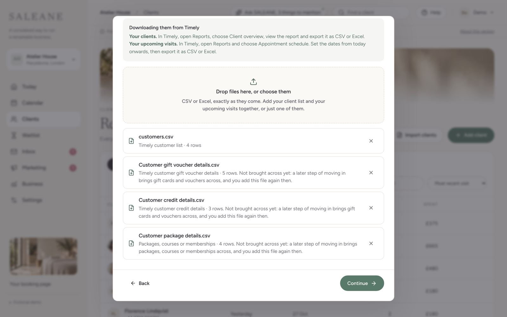
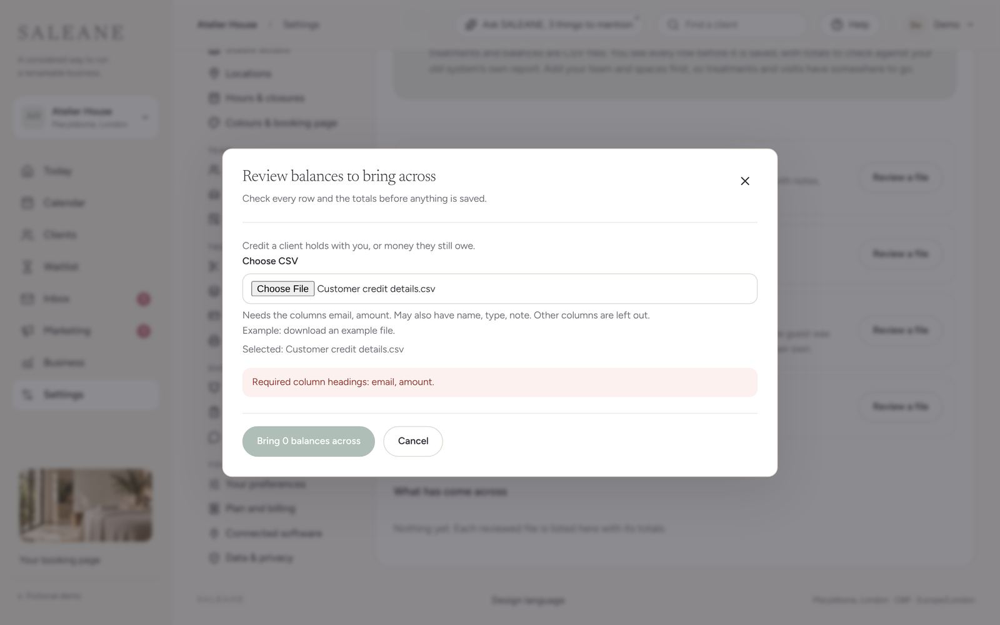

After, the same files are read as they come.

## What the owner sees

Clients, Import clients, and Settings, Switching over, Gift cards, packages and credit open the same screen, "Move in from your old system". A money file adds a **Money held** step between the clients (or visits) and Bring across.

1. **Your files.** Where to download each report in that system, now including gift cards, packages and credit ("In Timely, open Reports and export Customer gift voucher details, Customer package details and Customer credit details, each as CSV or Excel."). Where a system only gives them as PDFs or through support (Phorest's courses and credit, Booksy, GlossGenius), it says so. Treatwell's own gift cards stay with Treatwell, and the screen says that too.
2. **Money held.** Anything SALEANE is unsure of comes first: which treatment each package is for, with the studio's own treatments to choose from or "Leave these packages behind", and, for a credit file with no type column, which way round its amounts go. Continue waits for the answers. Then three figures (gift cards and what is left on them, packages and their visits left, credit and how many clients), each total checked against the old system's own, and a list of what stays behind and why, with notes on what comes across differently.
3. **Bring across.** One sentence for each kind ("3 gift cards with £225.00 left to spend. Each keeps its code, so guests use the card they already have."), "All of it was settled in Timely, so none of it counts as takings in SALEANE. No card is charged and no money is given back.", one tick, and the button. Clients are saved first, then gift cards, packages and credit, each in parts.

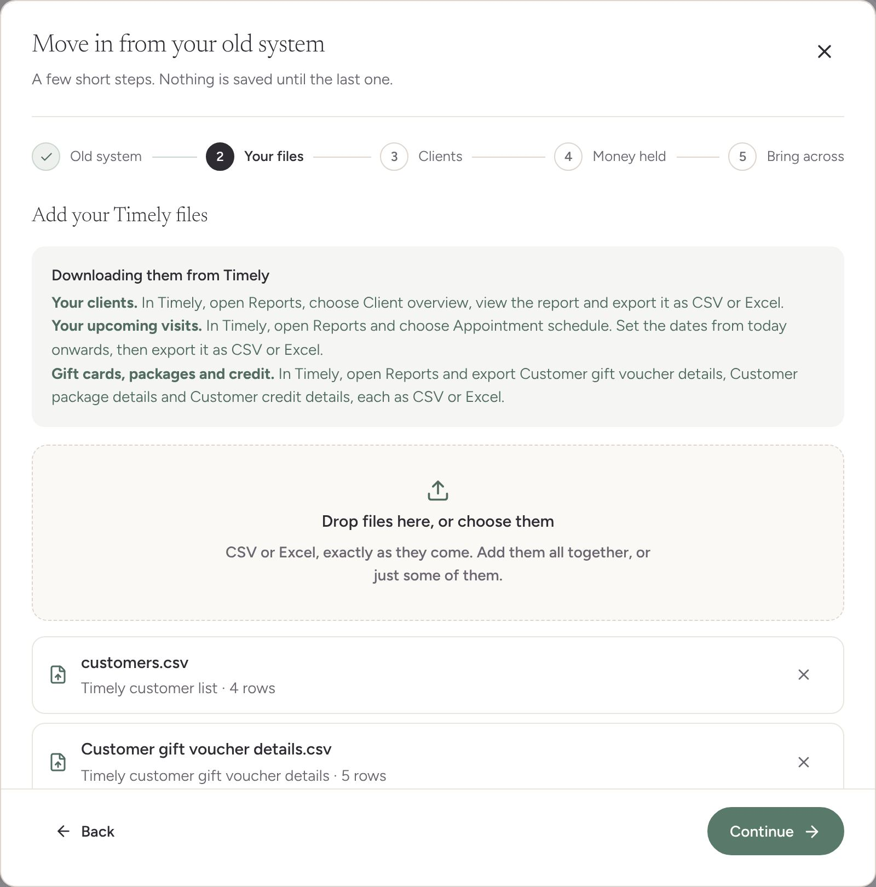
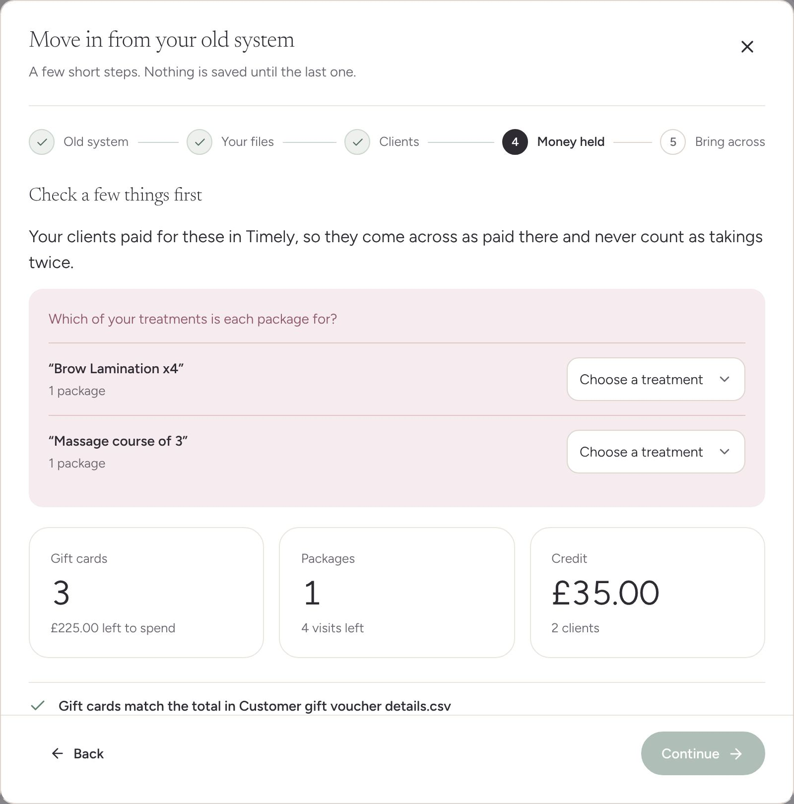
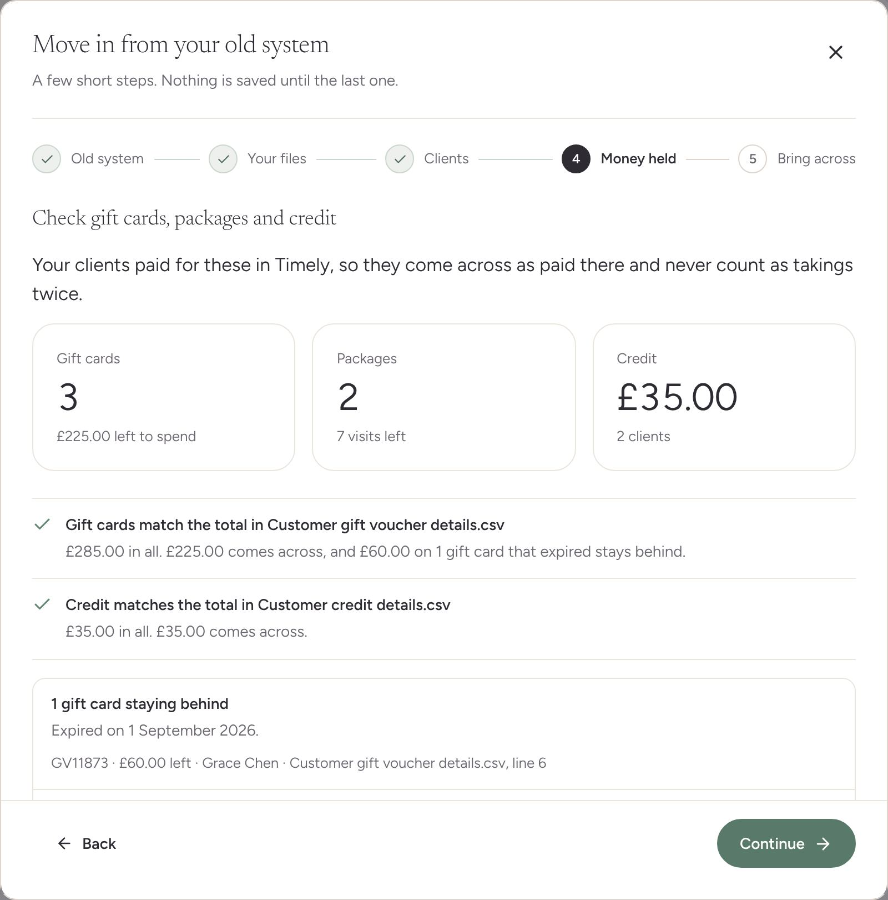
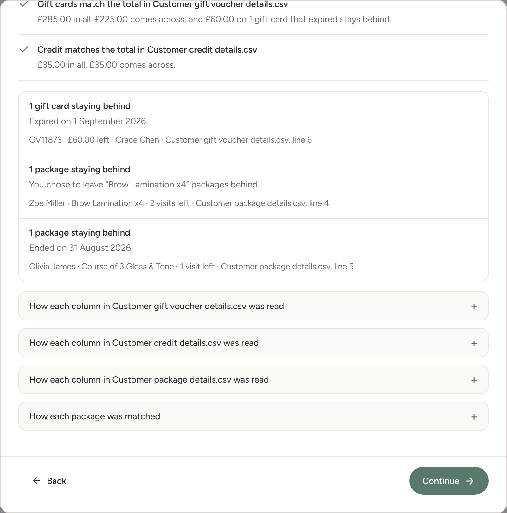
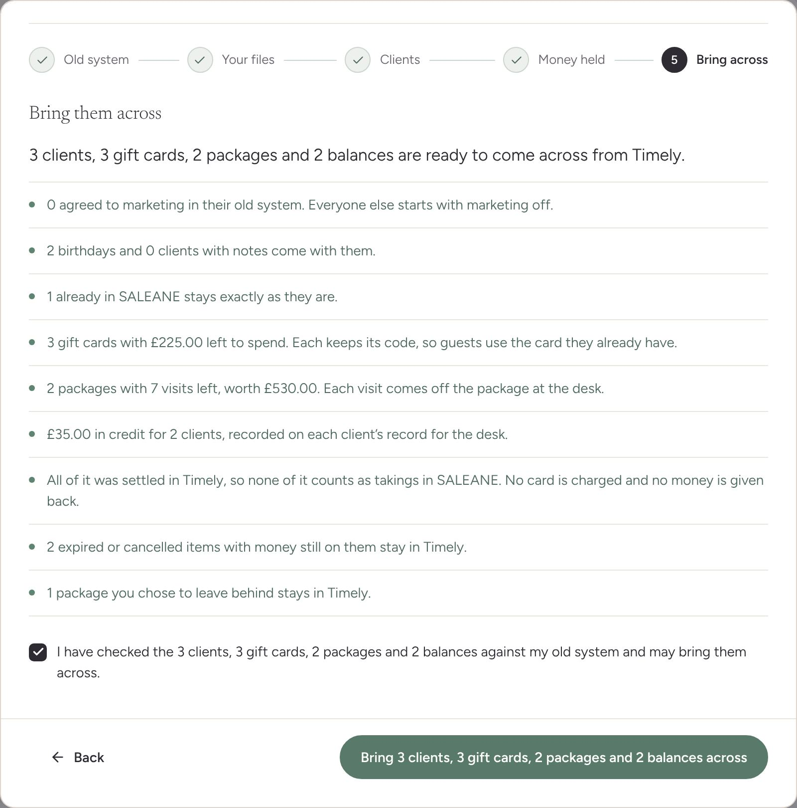
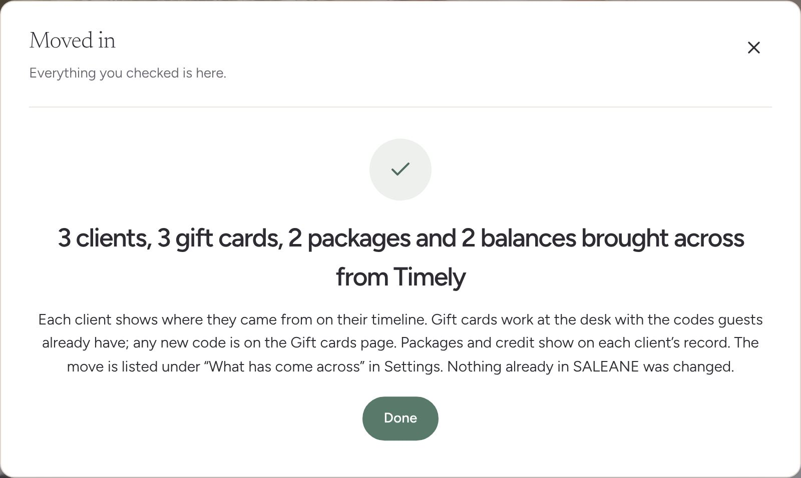

## Reading the old system's reports

- **Recognised by their headings:** Timely's customer gift voucher, package and credit details; Phorest's vouchers outstanding and client courses; Vagaro's packages (and its memberships, named and set aside); Square's gift cards; Fresha's liability summary, read as totals to check against, and its liability activity, named and set aside with the reason. Any other file is read by what its headings mean and what is inside them.
- **Codes and last days:** Timely writes a voucher's last day inside its code ("GV58214 (expires 31/03/2027)"); SALEANE keeps the code and the date apart. Square gives only the last four digits, so its cards get a new SALEANE code, and the last digits are kept for searching.
- **Totals rows** in a file ("Total,,,,,£345.00,£60.00,£285.00") are read as the old system's own figures, never as a card.
- **Money in every style:** £50.00, 50.00, -£5.00 and (£5.00).
- **Columns never read:** location, who sold it, payment method, tax, renewals, loyalty points and saved card details. Each one says why under "How each column was read".

## Rules kept

- **Nothing counts as takings twice.** Each carried card and package is recorded as paid to the old system (method `previous_system`), so it never appears in the day's takings, in Accounts, on a receipt, or in Gift cards' "Sold in total" or Money's "Taken for plans". It is still money the studio holds: gift cards are in "Waiting to be spent" and packages in "Package visits paid for, not yet used".
- **Gift cards keep their codes.** A code already in SALEANE, or listed twice, comes across once. A code too short or too long to keep (under four characters, say) gets a new SALEANE code and the old one is kept for searching. Adding the same file again, after a save that stopped part way, finds those cards by their last digits, what was left on them and who they were for, so none comes across twice.
- **Only what is left comes across.** Expired, cancelled and fully used cards and packages stay in the old system, and the total check says how much stayed behind and why. A card with no last day there is kept for ten years.
- **A package keeps its visits left and their worth.** "Bought for £480.00; the 4 visits left are worth £320.00." The client's page counts the visits used in the old system ("4 of 6 visits left"). A package with more than 100 visits, or unlimited ones, is a membership and is not brought across.
- **Two of the same package are two.** A client who bought the same package twice keeps both, the second numbered ("Course of 6 Skin Renewal Facials (2)"). Only the same report added twice is read once. Adding a report again finds each package already here by its visits left, worth and last day, so one saved before a save stopped is not hidden behind its twin.
- **Credit goes to the right client**, by email, then phone, then name, and two rows for one client are added together, since SALEANE keeps one carried balance for each client. A client who already has an open carried balance is left alone.
- **A newcomer is added only when something of theirs comes across**, with marketing off.
- **No card is charged, no money is given back, and nobody is sent a message.**

## Afterwards

The carried cards sit on the Gift cards page with their own codes, under "Carried over from Timely". Opening one says where it was bought and for how much, and its history begins "Carried over from Timely with £30.00 left to spend, paid for there". Nina Patel's page shows "Course of 6 Skin Renewal Facials, 4 of 6 visits left · use by 30 June 2027, Carried over from Timely, where it was paid for". Money, Plans shows £0.00 taken for plans and £530.00 held for visits not yet used. Settings lists each import under "What has come across".

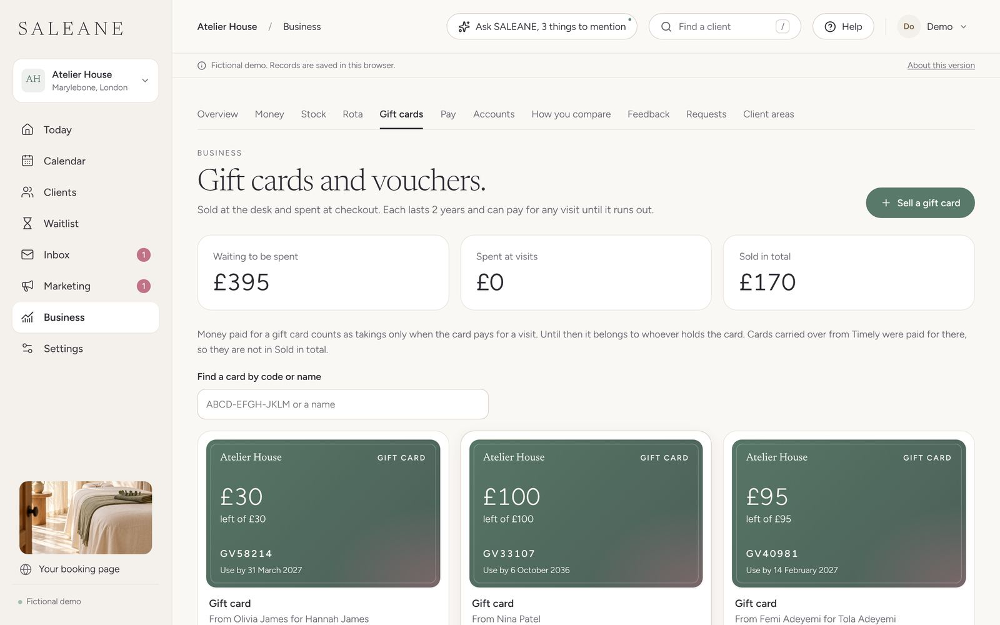
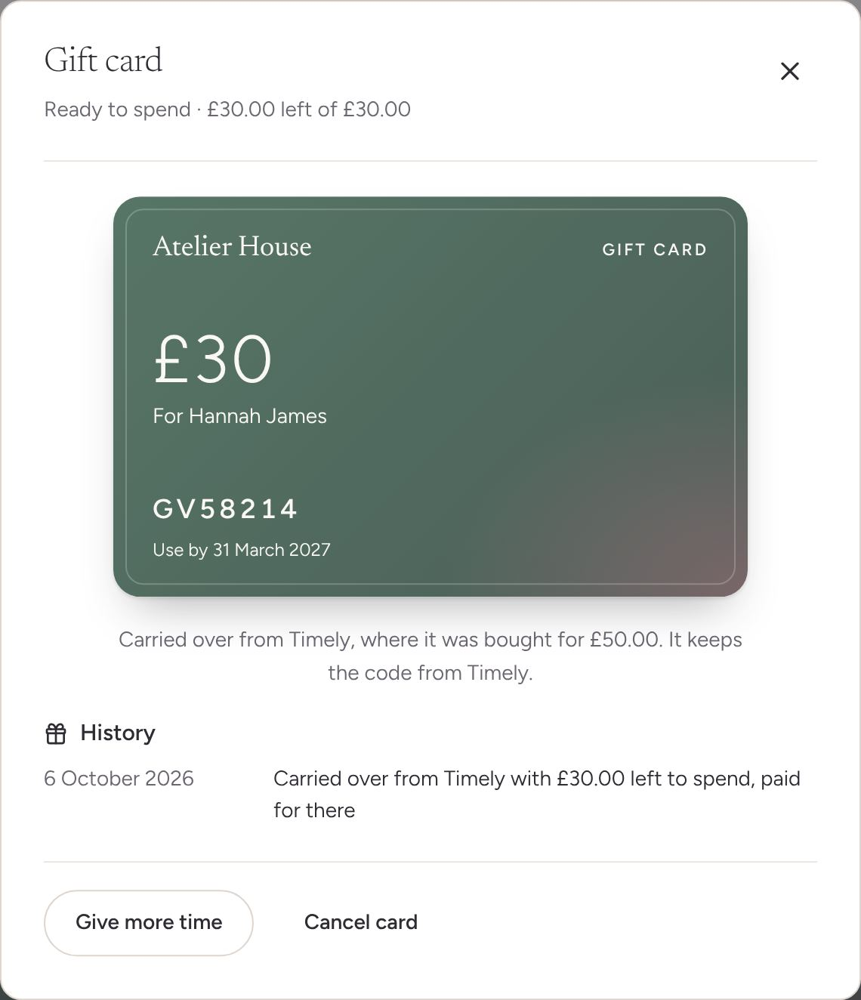
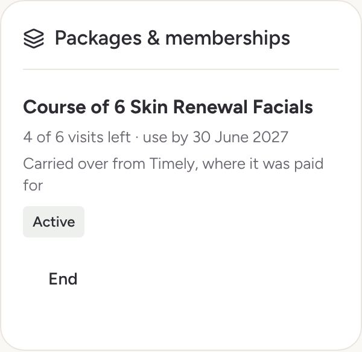
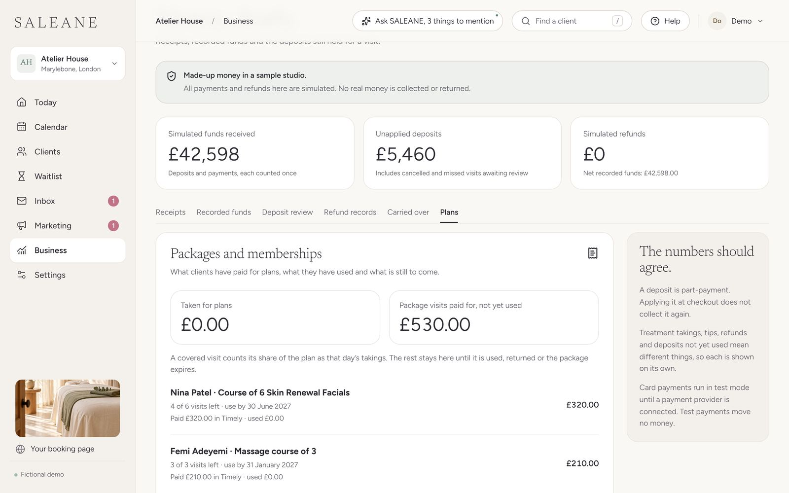

## How it was checked

- `npm run check` (lint, all tests, build) and `npm run format:check` pass.
- 21 domain tests in `src/domain/movingIn/money.test.ts`: codes with their last days, counts, statuses and money; each recognised report; a Timely review of cards, packages and credit with every rule above, its totals check, and a check that says when the rows do not add up; package matching, asking only when unsure; everything saved through the real commands, then reviewed again to find it already here; Square's last four digits, and its cards found again after a save that stopped part way; a card already here and a card listed twice; two of the same package in one report kept as two, and a report added twice read once; the very package already saved found again; the question about which way round credit goes; credit kept in a client list; a newcomer added only when something of theirs comes across; Fresha's liability summary; the older email and amount balances layout; parts of at most 200.
- 14 tests in `src/domain/carriedMoney.test.ts` for the new commands `import-gift-cards` and `import-packages` (at most 200 rows each): a carried card keeps its code and what is left, is held for the guest and is never a sale, pays for a visit at the desk, can be cancelled with money returned, and works in the sample studio; a card without a keepable code gets a new one; a carried package covers a visit at the desk, taking one visit and its share, or in full when the old system gave no value; treatments not offered here, a package already carried over and one that ended are refused; a record that says it was carried over without its import, or was paid here, is refused; only owners and managers may carry either over.
- Interaction tests: Timely's four reports walked to "1 client, 2 gift cards, 2 packages and 1 balance brought across from Timely", the saved codes, values and clients read back, then the client's page ("4 of 6 visits left · use by 30 June 2027") and the Gift cards page checked; Settings, Gift cards, packages and credit opening the same steps.
- Chromium at 1440 by 900 and 390 by 844 on the browser demo, with Timely's customer list (4 rows), gift voucher details (5 rows and a totals row), package details (4 rows) and credit details (3 rows and a totals row). 3 gift cards (£225.00), 2 packages (7 visits, worth £530.00) and £35.00 of credit for 2 clients came across; an expired card, a used card, an expired package and a package the owner chose to leave behind stayed in Timely. Nothing scrolled sideways on the page or inside the window at any step, and the browser reported no errors.

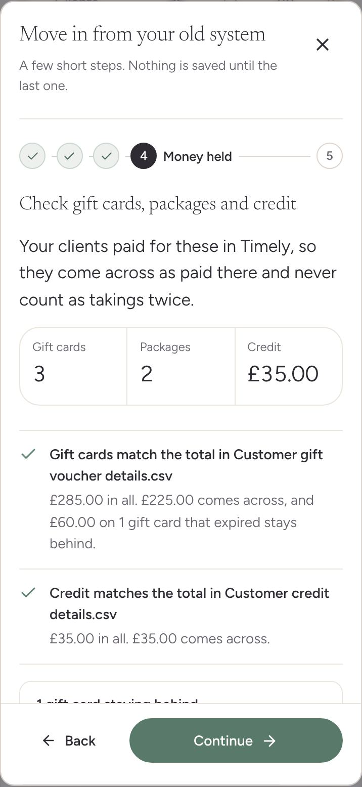

Found and fixed on the way:

- A package the owner chose to leave behind still showed its "coming across" note. Notes now show only for what comes across, and what was left behind by choice is listed under what stays behind.
- A package's last day in another year read "use by Wednesday 30 June". It now reads "use by 30 June 2027", which matters for carried packages that run for years.
- Searching help for "gift voucher" found moving in before the gift card guide. The guide's search words no longer compete.

## Quality bar

Worked through at 1440 and 390 pixels against the checklist in the design language (Quality bar).

- [x] **One main job and one primary button.** Money held has one heading and Continue.
- [x] **Rarely used options tucked away.** How each column was read, and how each package was matched, are folded away.
- [x] **No card inside a card.** Questions are rows with a hairline between them; the totals check is a list of hairline rows with a mark beside each; what stays behind is rows in one panel.
- [x] **At most one photograph.** None: these are working steps.
- [ ] **Empty welcome.** Not applicable: this is a dialog, not a page.
- [x] **Loading shapes.** Reading files now shows `LoadingShapes`.
- [x] **One way of moving.** The step carries `settle` like the others; nothing moves on its own.
- [x] **At 390 pixels.** Nothing scrolls sideways on the page or inside the window at any step; the three figures sit in one row.
- [x] **Words.** Plain British English, "visit" and "treatment" throughout, each reason saying what happens next.
- [x] **Built from the library.** Same `src/design` pieces as stages 1 and 2, with the Radix drop-downs from the polish pass.
- [x] **No left-edge stripes.** None.
- [x] **Before and after pictures.** Above, and side by side in [Moving in money, before and after](https://claude.ai/artifact/5vJEXAJ9UvFwXvQ88FKWb9).

## Not done yet, said plainly

- **No real export files yet.** Headings come from each system's published reports and help pages. Real files from trial accounts would confirm them.
- **Memberships** are named and set aside: they renew from a saved card, and clients save their card again through a link first.
- **Phorest's client courses and credit** print as PDFs; the owner asks Phorest for spreadsheets.
- **Loyalty points** do not come across.
- **Service vouchers** (a voucher for one treatment) come across as an amount to spend on anything, with a note saying so.
- Past visits (history), a practice move, moving day and US systems are later stages.
- Checked in Chromium only, not Safari or Firefox.
