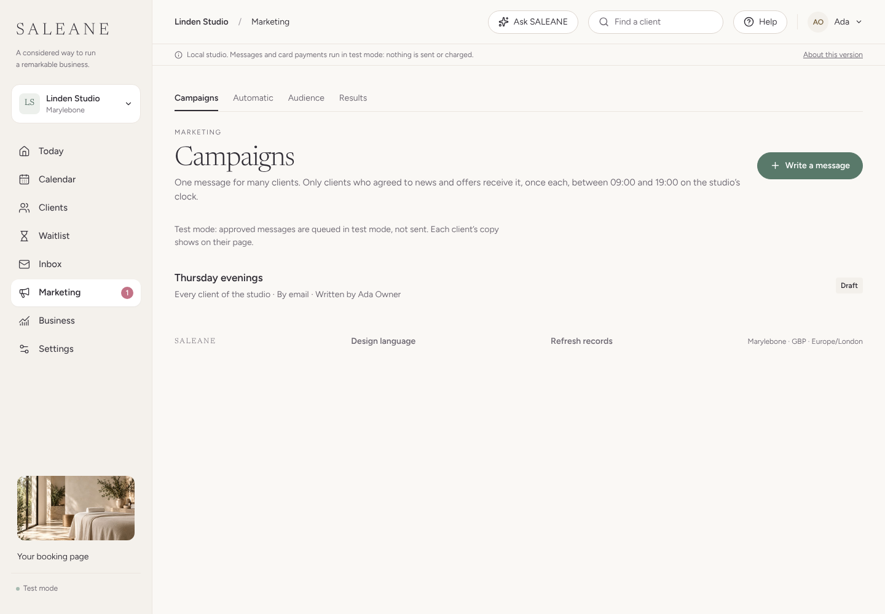
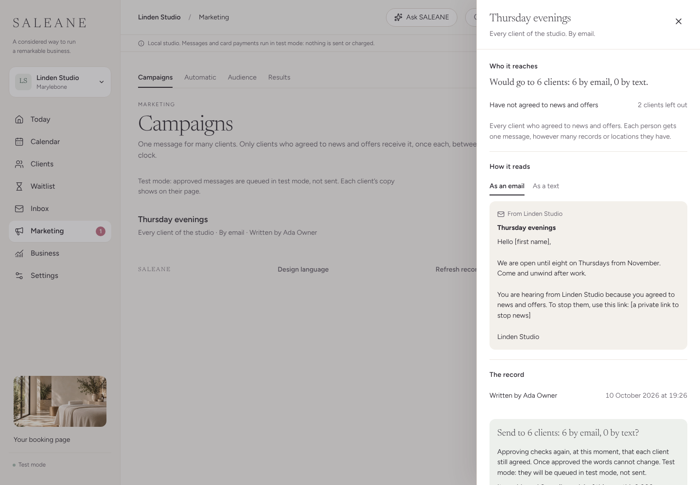

# NEXT-14 · Marketing, in its own section

Recorded 10 October 2026 on a local build (Chromium, 127.0.0.1:5173). A studio of its own, not a sample: Linden Studio, one location (Marylebone), eight fictional clients of whom six agreed to news and offers, and one campaign draft, "Thursday evenings". Email stays in test mode. To show the month's allowance without sending anything, rows were written straight into the local outbox as earlier sending would have left them: 1,640 birthday emails and 40 aftercare emails earlier that day, then 356 we-miss-you emails more.

## What it does

Marketing is its own item in the left-hand menu, between Inbox and Business, for owners, managers and general managers. It is not under Settings. A small number beside it counts drafts waiting for approval. It has four tabs:

- **Campaigns**: the left-out features' messages to clients (Stage 4A), moved here. One message for many clients, only to those who agreed, once each, in the daytime on the studio's clock.
- **Automatic**: the aftercare, due back, birthday and we miss you emails, each with a switch and a look at the email. These were in Settings, Messages; they keep the same settings, so the booking messages (confirmations and reminders) are untouched. Owners and managers change them; a general manager sees them without changing them.
- **Audience**: how many clients may hear from the studio, by email and by text, how many have not agreed and how many stopped, and how they stopped, month by month. Numbers only, never names.
- **Results**: what each campaign and automatic email did by month: sent, not sent, stopped hearing from you, and booked within two weeks. Above them, the month's marketing emails used against what the plan includes.

Each location's price includes 2,000 marketing emails a month, 10,000 with Plus. Campaigns and the due back, birthday and we miss you emails count, by the month a copy was queued on the studio's calendar. Aftercare, confirmations and reminders never count, and copies in test mode, failed ones and skipped ones count for nothing. It is a hard stop, like the AI allowances, so sending never costs SALEANE more than the studio pays: a campaign that would go over cannot be approved (the button is off, and the server refuses it in plain words), and an automatic email past the limit is skipped with "Not sent: this month's marketing emails were all used." News emails carry the one-click unsubscribe headers mail apps use (RFC 8058).

## Tests

- `server/news.test.ts`, "marketing" (3 tests): two locations give 4,000; 3,997 counted while test copies, failed ones, aftercare and last month's are not; a campaign to four is refused with "This campaign would send 4 emails, and 3 of this month's 4,000 marketing emails are left. Choose fewer locations, send it by text, or approve it next month." and nothing is queued; on 3 November it is approved, and its copies are set aside while they wait and still count once delivered. Results show only numbers, a general manager sees only their own location's campaigns and reception is refused. A sample studio has no allowance to count. Also "stops news from a mail app's own Unsubscribe button, with no page and no sign-in (RFC 8058)".
- `server/messaging.test.ts`: "sends no automatic marketing email once the month's marketing emails are used".
- `src/pages/Marketing.test.tsx` (6 tests): the automatic switches save without touching visit messages; a general manager cannot change them; the audience counts and never names; results show "1,640 of 2,000" with "360 of 2,000 marketing emails left this month." and each month's messages; "All 2,000 marketing emails for this month are used."; a sample studio has nothing to count.
- `src/domain/marketing.test.ts`: results by month and campaign, and large numbers read with a thousands comma ("1,640 sent · 1,200 not sent").

## Browser journey

1. The menu shows Marketing with its megaphone and a 1 for the waiting draft. Opening it shows Campaigns, Automatic, Audience and Results as tabs.

   

2. Results read "Marketing emails this month: 1,640 of 2,000" and "360 of 2,000 marketing emails left this month.", with October's birthday and aftercare emails below.
3. Opening "Thursday evenings" and choosing Check and approve said "It uses 6 of the 360 marketing emails left this month." with Approve on.
4. With 1,996 used, the same check said "It would send 6 emails, and 4 of this month's 2,000 marketing emails are left. Choose fewer locations, send it by text, or approve it next month." and Approve was off. Sending the approval to the server anyway was refused (409) with the same words.

   

5. Automatic and Audience showed their switches and counts.

axe (WCAG 2.2 AA tags) found nothing on Campaigns, the approve check (both within and over the limit), Results, Automatic and Audience, at 1440 px and 390 px. There was no sideways scroll at either width and there were no console errors. The walk showed Results writing "1640 sent" without a comma; it now writes "1,640 sent", checked in `src/domain/marketing.test.ts`.

## Not covered

No email was sent: email stays in test mode until a sender is connected, and the counts in the walk came from rows written into the local outbox. Safari and Firefox were not checked. Texts are not part of the allowance; they come later as paid bundles.
