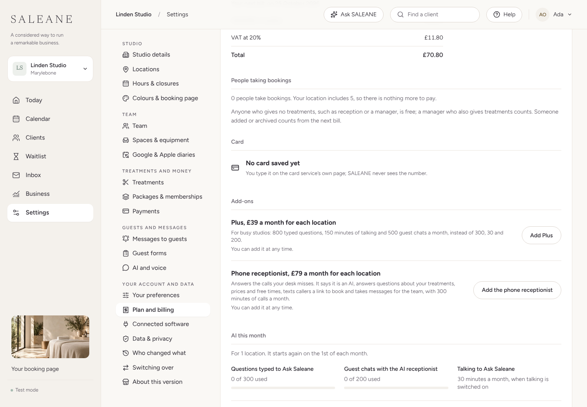
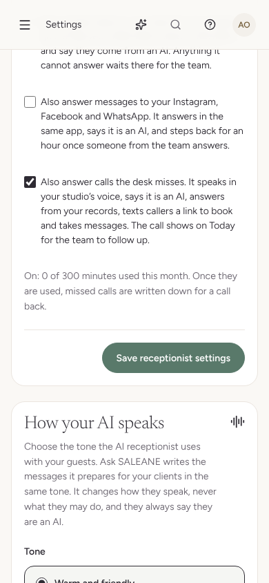
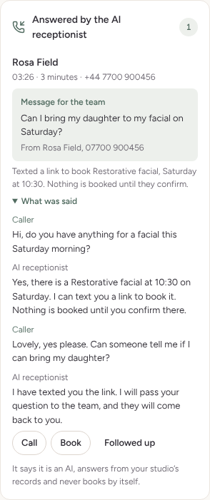
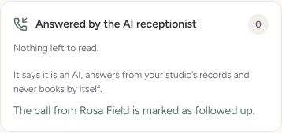

# NEXT-17 · The AI receptionist answers calls the desk misses

Built locally on 11 October 2026. Not run against a real phone line or OpenAI project: Twilio, OpenAI and Claude are pretended in the tests, and the browser walk ran with walk-only settings that make calls show as connected while nothing is ever called out.

## What it does

- When the studio's Twilio number reports that nobody at the desk answered, and the studio has the phone receptionist and has ticked Also answer calls the desk misses, SALEANE dials OpenAI's SIP address for the project instead of saying sorry, carrying a one-off code (`server/phone.ts`, `divert`).
- OpenAI's signed webhook says the call has arrived. SALEANE checks the signature and its time (`server/openaiWebhook.ts`), thanks OpenAI at once, then holds the call's minutes, accepts it with the studio's voice and instructions (`src/assistant/phone.ts`) and follows it. A call nobody handed over, or one whose code was already used, is turned away with SIP 603; one the studio cannot take, with 486.
- OpenAI's GPT-Live listens and speaks. Every question goes to the AI receptionist with Claude, on the phone channel (`src/assistant/receptionist.ts`, `phoneFacts`): short spoken answers, no web addresses, no health advice, never a booking. A time it offers is texted to the caller as a booking-page link through the outbox (`call:` slot), only when the caller's number is known, at most twice a call, and never after the caller hung up. A message for the team is kept with the call.
- Each call holds up to ten minutes, or what is left of the month's minutes if less (30 seconds at the least). SALEANE ends it when the window is up, counts it from what OpenAI reports (or its own clock when OpenAI goes quiet) and adds any later cost. On shutdown, calls still running are hung up and counted.
- As a call ends it is written down with the `call-answered` command, which only the phone line can send: who called (matched to one client by number), when, how long, what was said (up to 60 turns), any link texted and any message. It is part of the client's export and their erasure review.
- Today shows Answered by the AI receptionist under Needs you while a call from the last week waits; the desk reads it, calls back or books, and marks it Followed up (`answered-call-done`).
- A handed-over call that never reached the AI (`/api/hooks/twilio/voice/:slug/ai`, any outcome other than completed) is written down as a missed call, as before.

## Paying for it

- The phone receptionist add-on is £79 a month for each location ($99 in the US, a placeholder), with 300 minutes of calls and its own room in the AI spending limits (6 dollars a day and 25 a month for each location, in what the suppliers charge). It works like Plus: chosen during the trial it starts with the first bill; added part way through a paid month it is charged for the days left; turned off, it lasts to the end of the month. Each month's bill carries a Phone receptionist line.
- Plan and billing offers it only when calls are connected on SALEANE's server. Until then it shows Not yet, and the server refuses it (409), so nothing is sold that cannot work.
- Migration 30 on this branch adds `phone` and `phone_next` to `studio_plans`, and rebuilds `studio_invoices` with the same columns, keys and indexes, a `phone` column and the new `phone` kind, keeping every bill. **It is renumbered to the next free number (expected 38) when this branch is rebased after the left-out features (30 to 35) and Face ID (37).**

## Checks

- `npm run check`: lint, 1,258 app tests and 443 server tests (2 skipped), and the builds, all passing; `npm run format:check` clean.
- `server/phone.test.ts` (10 tests): webhook signatures and their five-minute window; the phone line settings; a whole call (handed over, accepted with the studio's voice, a question answered by Claude, a link texted once through the outbox and sent, counted at 125 seconds from OpenAI's report, written down with the client matched, a repeated webhook ignored, followed up); calls turned away; a forged webhook refused; the missed call kept when the studio has no phone receptionist and when the handed-over call fails; a call ended when the month's minutes run out; and the add-on refused until calls are connected, then charged for the days left with its line on the monthly bill.
- `src/domain/answeredCalls.test.ts`, `src/components/ReceptionistSettings.test.tsx`, `src/components/PlanBilling.test.tsx` and `src/components/todayColumn.test.tsx` cover the record, the export, the allowance, the bill, the settings wording and the Today card.

## Browser walk (Chromium, 1440 and 390 pixels wide)

Plan and billing, AI receptionist settings and Today were walked at both widths with axe (WCAG 2.2 AA): no violations, no sideways scrolling, no console errors.

## Still needed for real calls

A Twilio number forwarding to SALEANE, an OpenAI project with SIP and a webhook pointing at `/api/hooks/openai` (its id and secret as `OPENAI_PROJECT_ID` and `OPENAI_WEBHOOK_SECRET`), the OpenAI and Anthropic keys, and hosting so the webhooks can reach SALEANE. The OpenAI SIP calls follow OpenAI's published interface and have not been run against it.
