# QUALITY-01 · Quality bar for every screen

Recorded 9 October 2026 on a local build (Chromium, 127.0.0.1:5173). Two studios were used: the browser demo (Atelier House, 6 October 2026) and a new local studio, Linden Studio in Bath, created through Create an account with no clients, treatments or team. The "before" pictures come from `main` at `016f3ca` on the same database.

The bar itself is in [DESIGN_LANGUAGE.md](../DESIGN_LANGUAGE.md#quality-bar).

## Tests

- `src/design/qualityBar.test.tsx` (7 tests): an empty page with a photograph shows a heading at the level asked for, a decorative photograph with empty alternative text and one next step; a small empty state has neither; loading shapes announce their label once as a status and hide the shapes themselves from screen readers; more options start closed and open when asked; a new studio's Clients page shows "Your clients will gather here." with no table and no segment filters, one Import clients button, no second Add client button in the header, and Add your first client opens the new client dialog; a new studio's waitlist shows "Nobody is waiting yet." with no figures and one Add to the waitlist button; a read-only studio sees no button.
- The existing waitlist test in `src/design/design.test.tsx` still finds the shared header and its action on the demo, and every test that waits for a page to load still finds `.route-loading` go away.

## Browser journey

1. New studio, Clients. Before: an empty table with five filters at zero and "No clients found: try a name, email or phone number". After: the reception photograph beside "Your clients will gather here.", one line, Add your first client and Import clients. The header photograph and header buttons step aside so there is one photograph and one way to add. Add your first client opens the new client dialog, which fades and settles in.

   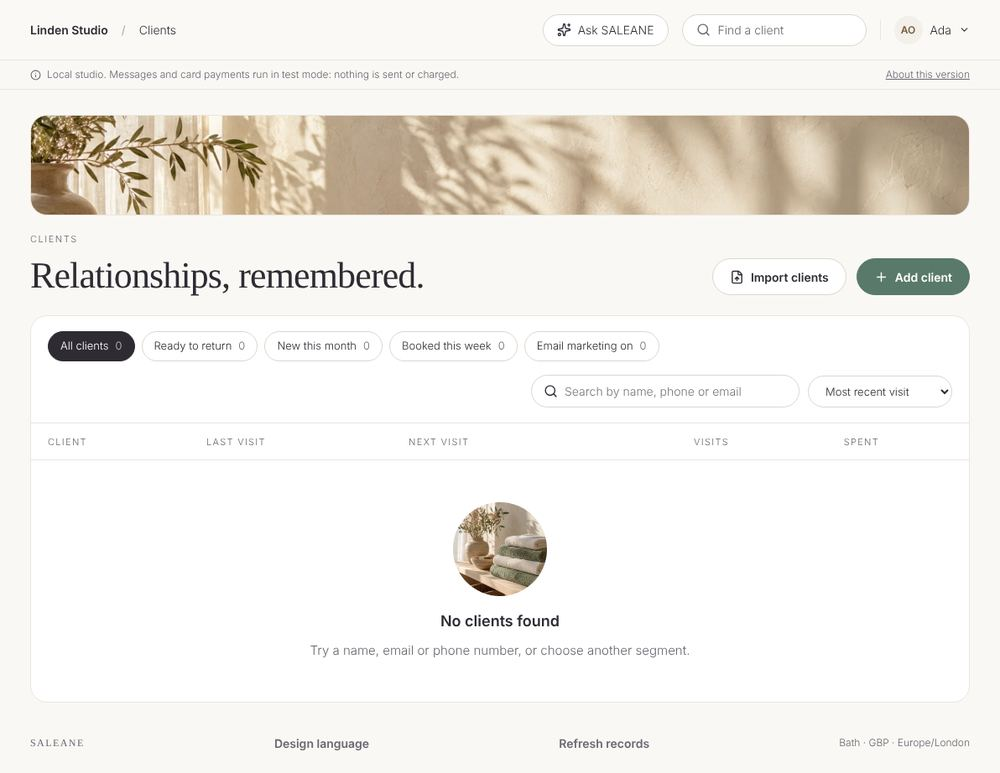 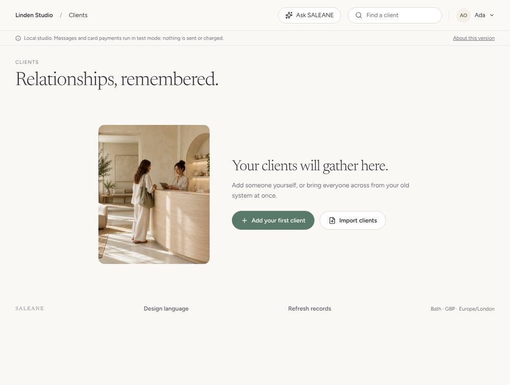

2. New studio, Waitlist. Before: three figures at zero and an empty panel. After: "Nobody is waiting yet." beside the tea photograph, one line and Add to the waitlist.

   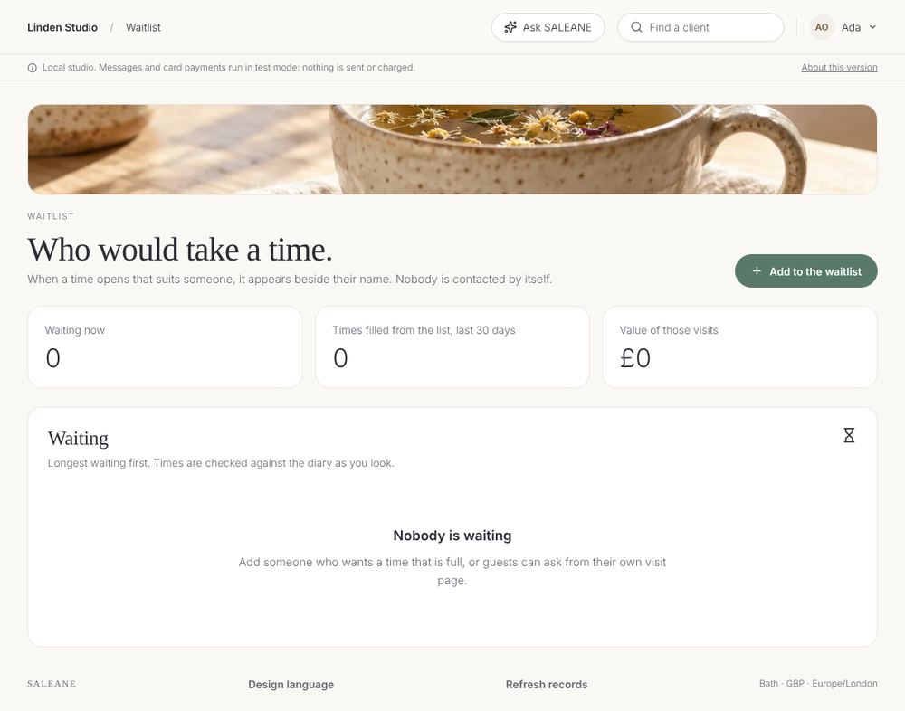 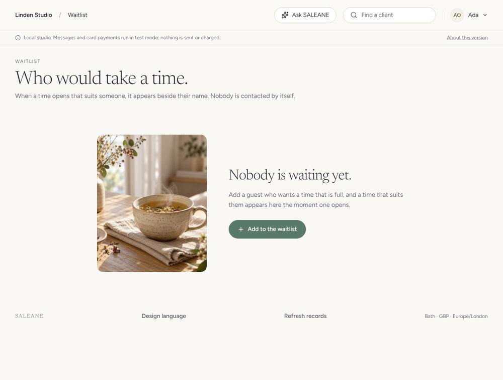

3. Demo, Waitlist with three people. Before: a stone box for each person inside the white panel, a white tag inside that, and Take off the list as an outlined button as strong as the times. After: one row per person with a line between, the tag on a quiet stone pill, the times as the clear thing to press and Take off the list as a quiet text button.

   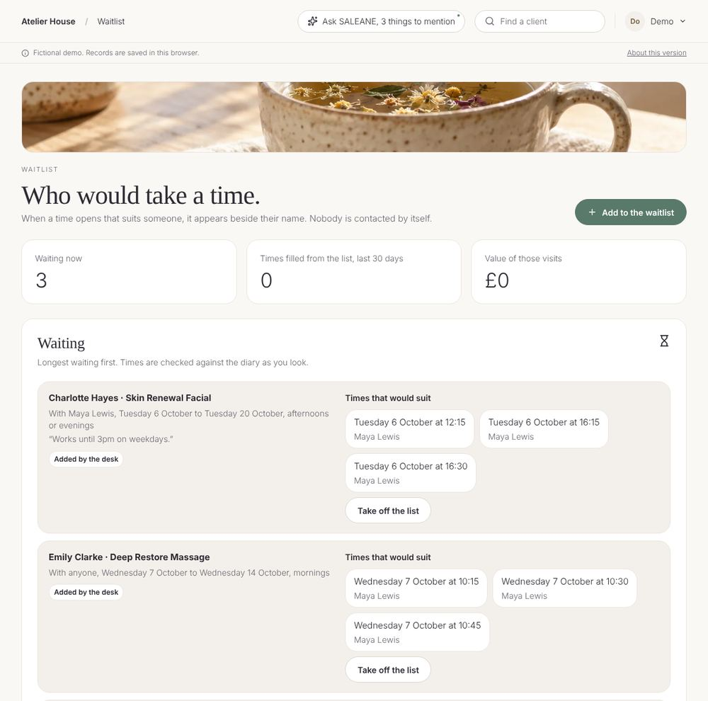 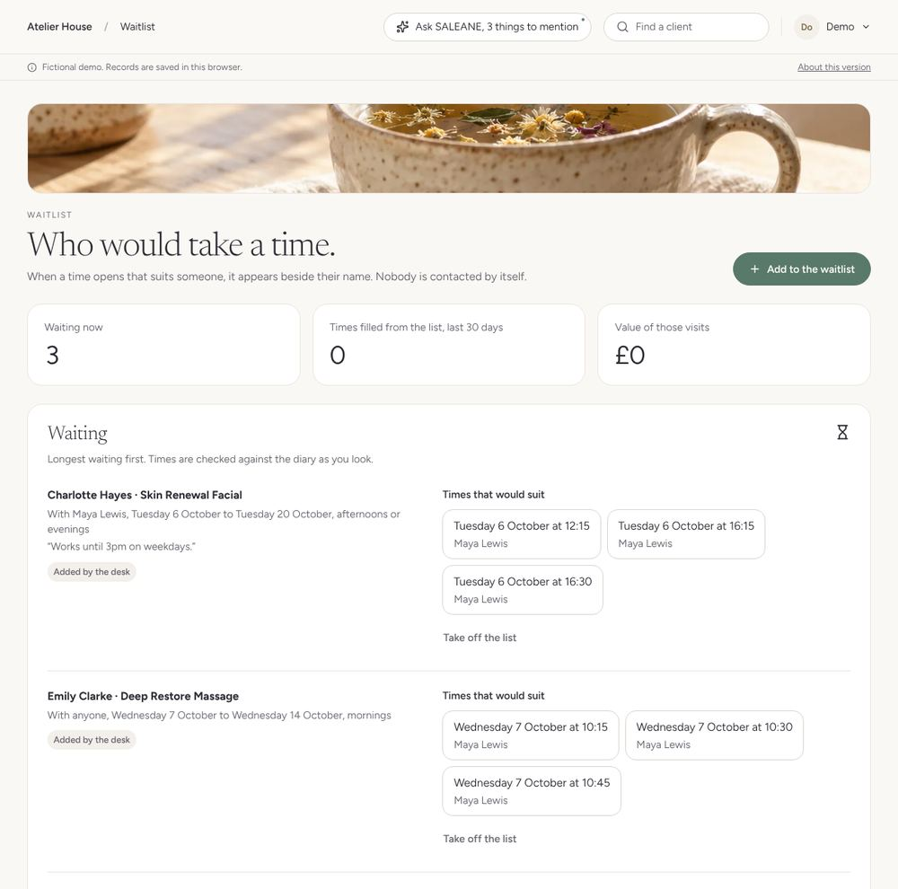

4. Business opened directly with its code held back for five seconds. Before: blank space under the tabs. After: a heading, four figures and a list drawn as soft shapes, appearing after a fifth of a second and breathing slowly until the page arrives.

   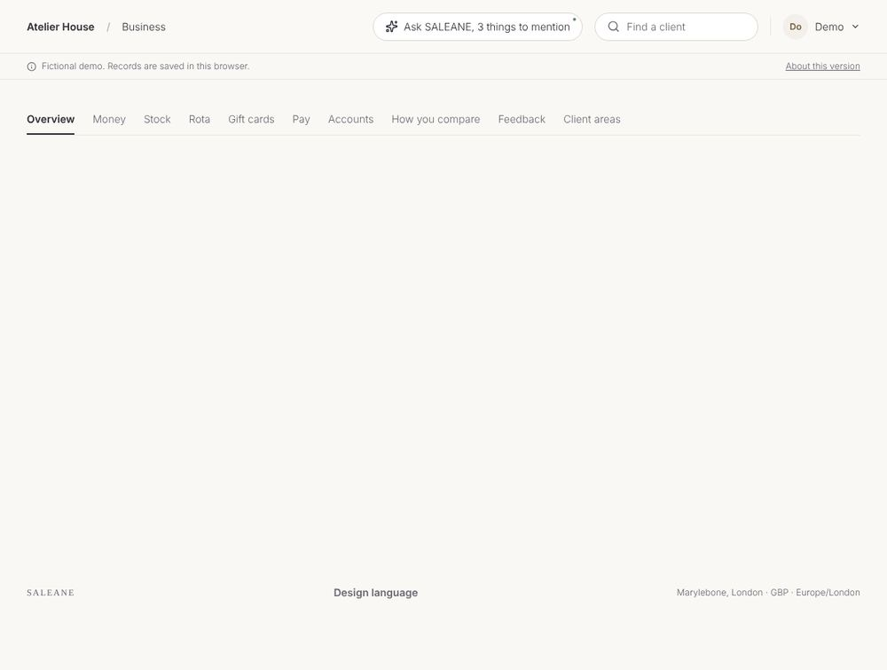 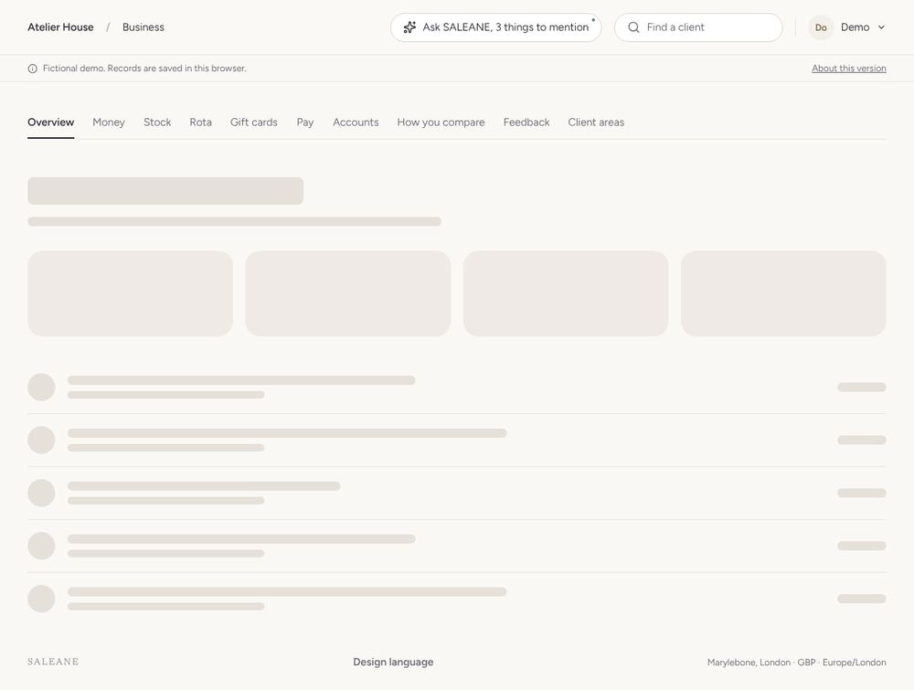

5. At 390px wide: the photograph sits above the words, the buttons fill the width at the foot of the page, and nothing scrolls sideways on any of the four.

   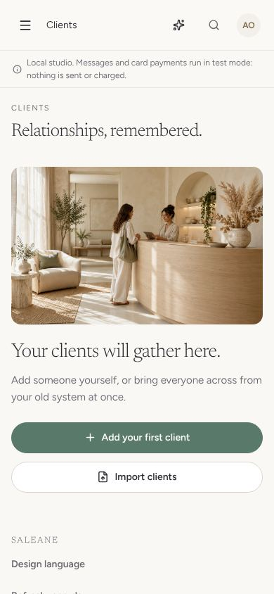 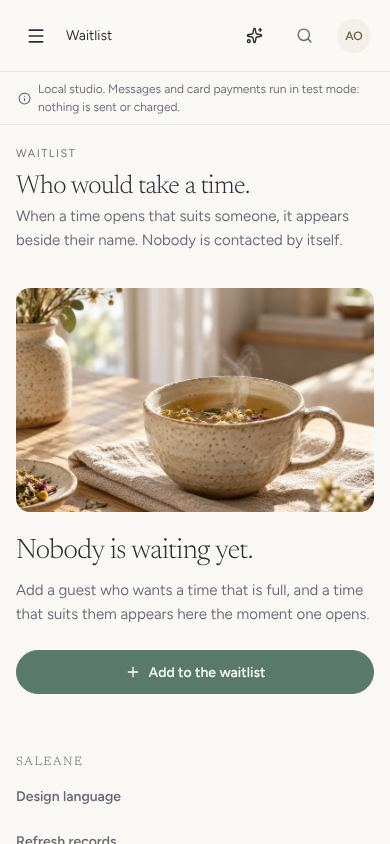 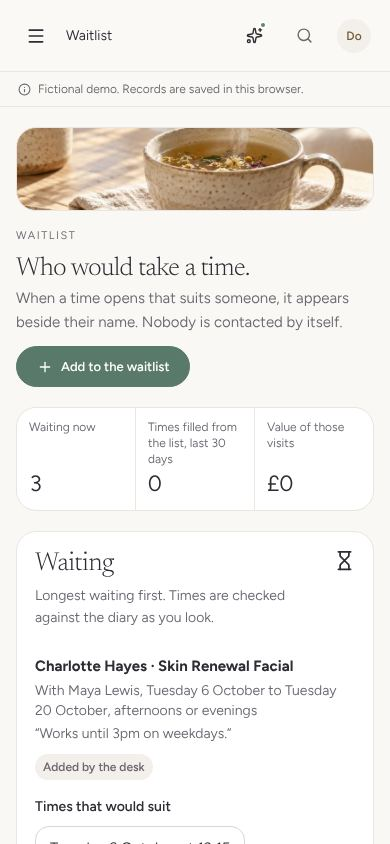 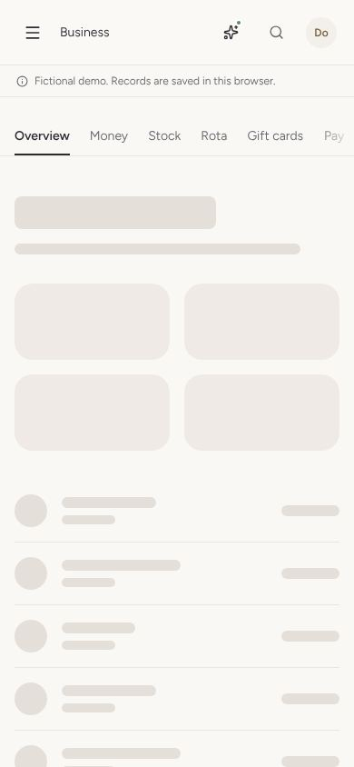

6. Motion: the new client dialog was part-way faded in 80 milliseconds after opening and fully shown by 500; Escape still closed it at once. A visit's side panel on Today slid in from the right and settled. With reduced motion asked for, the dialog was fully shown at once.
7. A missing address (/nowhere) shows the towels photograph, "This page isn't here." and Return to Today.
8. `/design-language` shows the new empty page, loading shapes, more options and a "Show it again" motion example.

axe (WCAG 2.0, 2.1 and 2.2 A and AA tags) found nothing on the new studio's Clients and Waitlist at 1440px and 390px, the demo waitlist at both widths, or the missing page. No console errors.

## Not covered

Safari and Firefox were not checked. Only these screens were changed; the full polish pass across every page comes later. A new studio's Calendar still shows an empty grid with no one on it, which is for that pass.
