# Set up your studio, and add a location

Built locally on 9 October 2026 at the owner's request ("ok do that"). Nothing is deployed, nothing is charged and no message is sent.

## What was checked

- Domain tests: `src/domain/setup.test.ts` (saving each setup screen together, refusing all of it when one change fails, never moving the owner back, readiness, owner only; opening a location with its rooms, team days, new people and menu, refusing closed days, unknown people, duplicate names and unknown treatments, keeping house rules and booked visits), `src/domain/setupScreens.test.ts` (an empty studio taken through all eight screens to taking bookings, each screen's plain-words problem, coming back to change or remove saved treatments, deposits and tax), `src/domain/locationOpening.test.ts` (the starting menu and rooms, the one saved change, each screen's problem, core treatments and the price band, booked visits shown before saving).
- Server tests: `server/setup.test.ts` (the owner saves a screen and the server remembers where they reached; a manager is refused even for a change they could make in Settings; a change outside setup is refused; only the owner opens a location).
- Screen tests: `src/pages/StudioSetup.test.tsx`, `src/components/LocationOpening.test.tsx`, `src/components/GetReady.test.tsx` and `src/pages/Account.test.tsx` (a new studio of their own opens on the setup screens; a sample studio opens on Today).
- Browser, Chromium at 1280 × 900 and 390 × 844 against the local server on 127.0.0.1:5173 with a fresh database: a new owner signed up, went through every screen, left at Team with "Finish later", came back from Today with "Pick up where you left off", finished and opened for bookings. In a sample studio, the owner added Islington with its own hours, one treatment left off and one priced differently, the two suggested rooms, Theo on his day off and a new stylist on Fridays. Choosing Maya's Thursday listed the 30 sample visits it would strand and held Continue. No horizontal scrolling at 390 pixels.

## Before and after

Before, a new owner landed on Today with a list of eight links into Settings.

After, they land on "Set up your studio": one job per screen beside a house photograph, saved on Continue.

Before, "Add location" was a single form for the name, address and hours; rooms, people's days and prices were set afterwards in three other places.

After, six short steps, saved together at the end.

## The first weeks, and a welcome for the team

Added on 9 October 2026 after the owner said yes to both. Checked in `src/domain/firstWeeks.test.ts` (each step ticks itself from the record, the sign-in and the team list; starting fresh, working alone and the usual reminders count as answers; the eight weeks start with the first visit booked here, not with visits brought across), `src/domain/welcome.test.ts` (three lines and three places for every role, in plain words, naming the location or region), `src/components/GetReady.test.tsx` (the list follows once the studio is ready, the links, never saying a message or payment went out, a manager seeing five steps, hiding, sample studios) and `src/pages/TeamWelcome.test.tsx` and `src/pages/Account.test.tsx` (a practitioner joining from an invitation reads the three screens, then opens their own day; skipping; where a manager can turn on two-step sign-in later).

In Chromium against the local server, the owner who had just opened Linden Studio saw "Your first weeks" on Today, answered "I am starting fresh", and invited Priya Shah as a practitioner, which ticked "Invite your team". Priya joined from the link in a separate browser, went through the welcome, opened the two-step setup from it, and landed on her own day. No horizontal scrolling at 390 pixels.

Before, Today had nothing after the ready list was done.

After, "Your first weeks" follows, and each step ticks itself.

Before, someone joining landed straight on their day (a practitioner's is shown; it is still where the welcome ends).

After, three short screens first.

## Quality bar pass (9 October 2026)

Checked against the quality bar in `docs/DESIGN_LANGUAGE.md` (from the quality bar pull request) at 1440px and 390px in Chromium, on a new studio made through sign-up and setup, a practitioner joining it from an invitation, and the owner adding a second location. Targets were measured in the browser, not judged by eye.

What changed:

- **Your first weeks** has one main button: the first step there is to do. Its number is filled, and on a phone its button fills the width. Once the link is copied the next step takes over. Every button in the list is now 44px tall (it was 40px), and "Hide this list" is 44px on a phone. A step's tick settles in when it is done.
- **The welcome** keeps one main button on each screen. On "Keep your sign-in safe", setting up two-step sign-in is now a secondary button beside "Open your day" (both were filled before), and while it is being set up, "Turn on two-step sign-in" is the main button and "Open your day" steps back.
- **On a phone**, the main button of each wizard fills the width at the foot of the step, with Back beside it (it was a small button on the right). Every target in the setup and location wizards is at least 44px.
- **Adding a location** no longer puts cards inside the window: rooms, team and the summary are rows with hairlines, and the bill sits in the open below them.
- Each step of all three wizards has `settle`, keyed to the step, so steps arrive with the shared calm motion once the quality bar's styles are in.

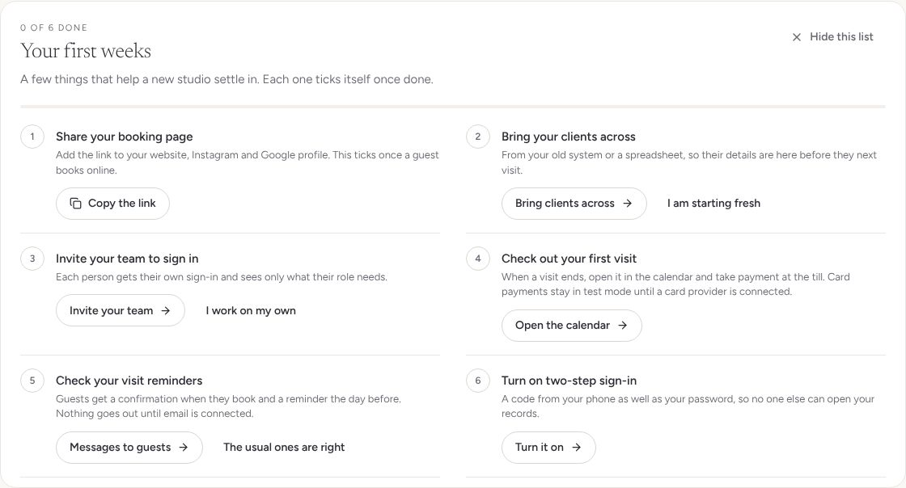
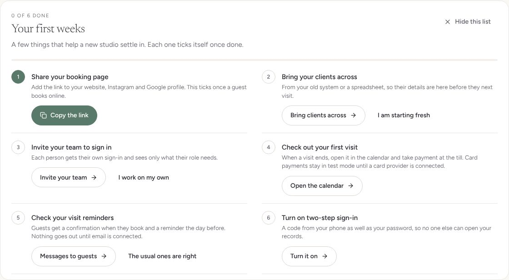
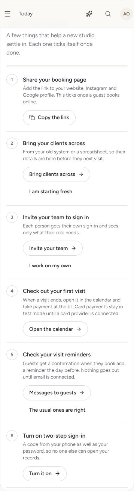
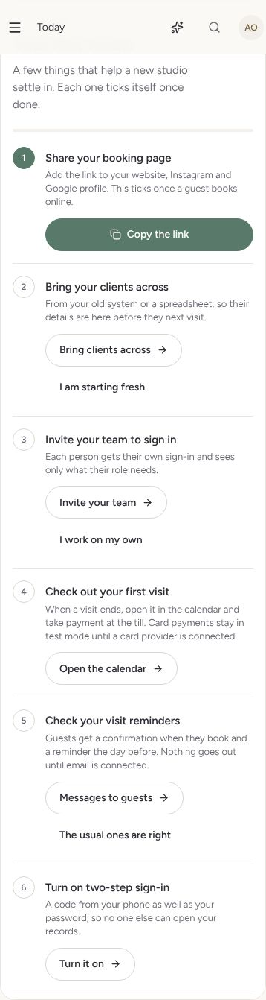
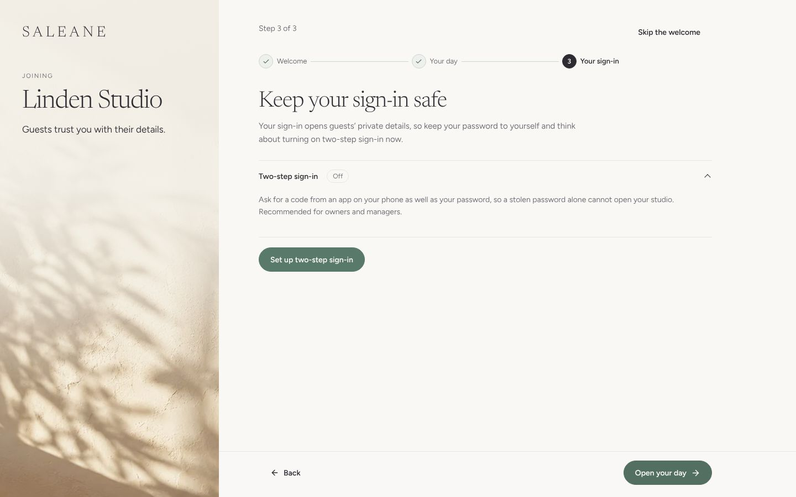
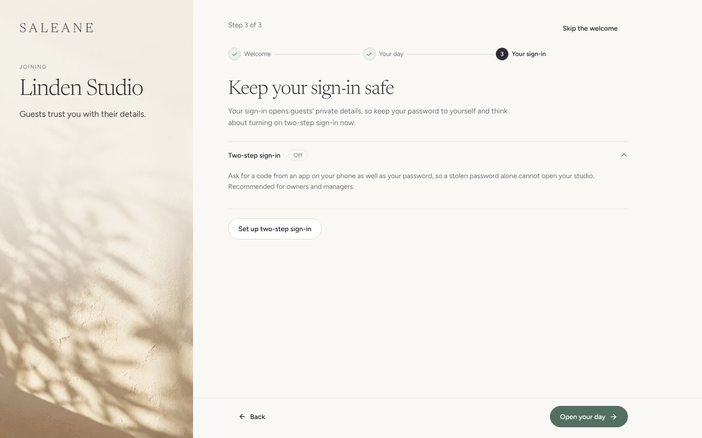
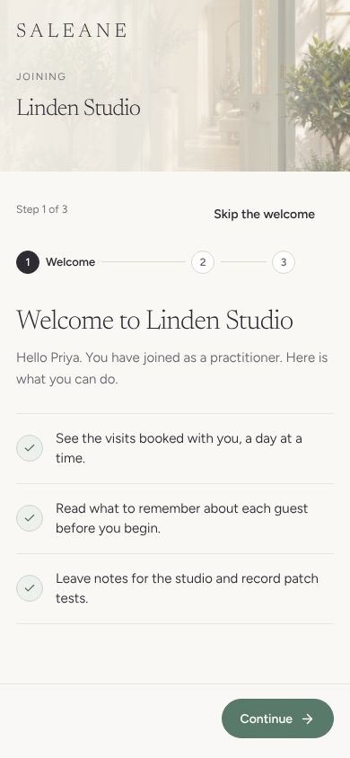
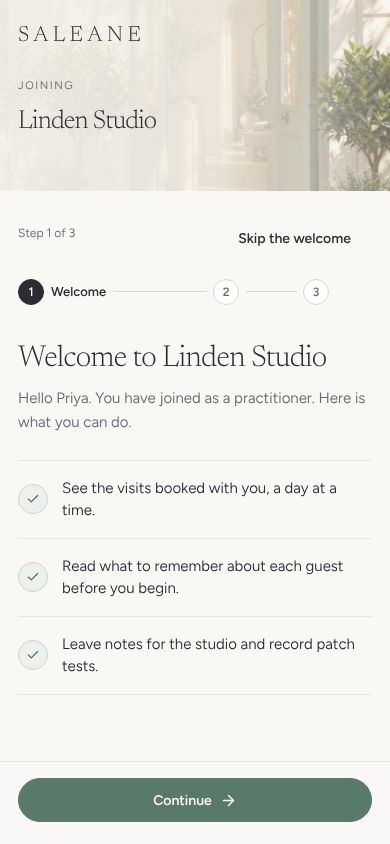
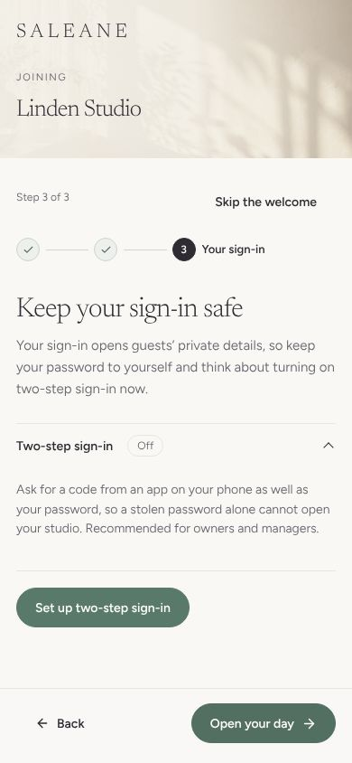
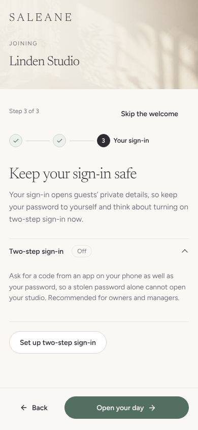
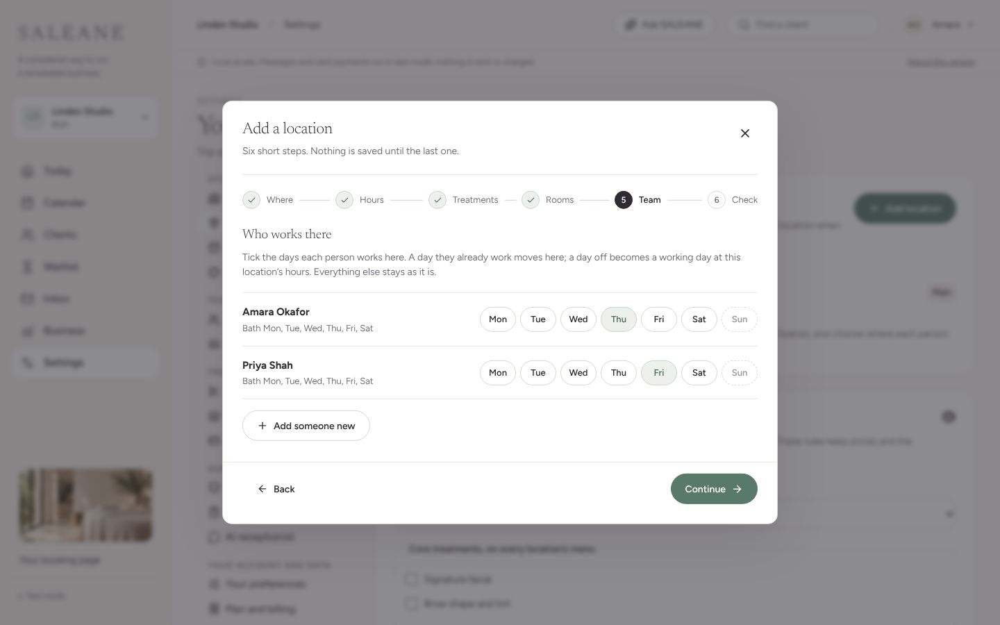
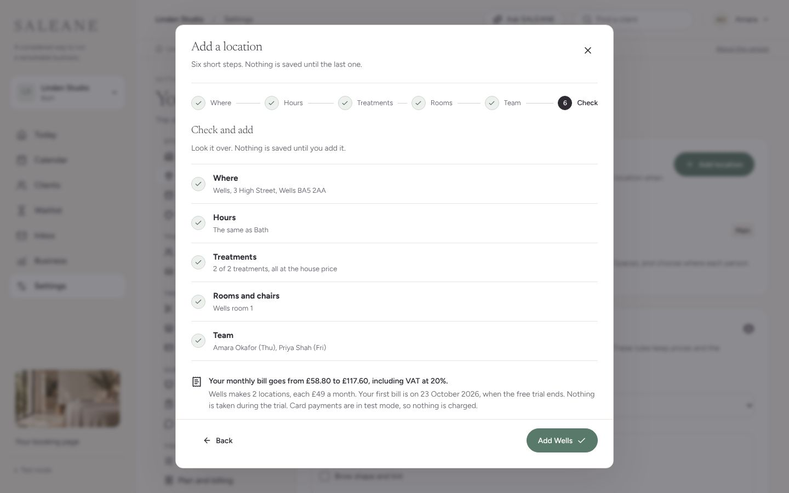
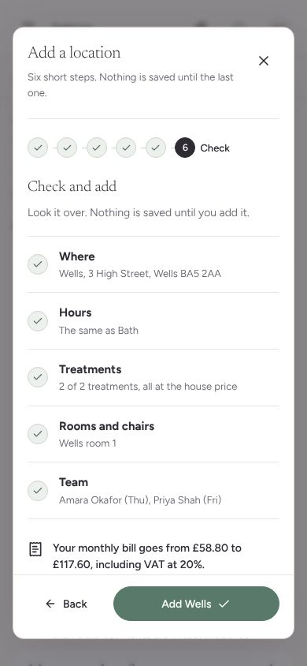

Checklist:

- [x] Each screen or section has one main job and one primary button. (Today keeps "New visit" in its greeting; the first weeks list is its own section with one.)
- [x] Rarely used options are tucked away. Nothing here needed `MoreOptions`: each step shows only what that step needs.
- [x] No card sits inside another card; lists use rows and hairlines. Fixed in the location window. The setup wizard's rows sit on the open page, not in a card.
- [x] At most one photograph per view, framed large and fading into the words: the setup and welcome columns. None on Today's list or in the location window.
- [x] Empty pages: none of these screens is an empty page.
- [x] Loading: nothing here waits on a whole page. The first weeks list and the location bill show at once with what is known and fill in the rest (whether the team was invited, the exact bill) without a blank space or a spinner. `LoadingShapes` arrives with the quality bar pull request.
- [x] Motion: every step has `settle`, keyed to the step, and a step's tick settles in. The styles and the reduced-motion rule come with the quality bar pull request; until then steps simply appear.
- [x] At 390px: no sideways scroll on any screen; every target in the list, the welcome and both wizards is at least 44px; the main button fills the foot of each step. One exception, not in this change: the shared window's close button is 40px everywhere in the app.
- [x] The words read plainly: the bill says what changes and when, and that nothing is taken today.
- [x] Built from `src/design` tokens and components, with no new raw colours; `npm run check` and `npm run format:check` pass.
- [x] Before and after pictures above.

## Someone at a new location who gives its treatments (10 October 2026)

A code review of the merged wizards found that a location could be added with nobody working there who gives a treatment on its menu. For example, a location offering only facials with only a brow artist working there. Guests can book a treatment only with someone who gives it, so that location could take no bookings at all, and nothing said so.

What changed:

- **The Team step** will not go on while nobody chosen gives a treatment on the menu there: "Nobody you have chosen gives a treatment on the menu here, so guests could not book. Choose someone who does." Someone ticked with no days there counts for nothing.
- **Saving** refuses the same location too, on the server as well as on screen: "Nobody working at Wells gives a treatment on its menu, so guests could not book there. Choose someone who does." A closed day or an unknown person is still named first, and nothing is saved either way.
- **Treatments nobody there gives yet** are named, on the Team step and on Check, without stopping the owner: "Nobody working here gives Signature facial yet, so guests cannot book it at Wells until someone does." The location can still open, for instance while a new person is being found.
- **Each person's role** now shows beside where they work on the Team step ("Brow and lash artist · Bath Mon, Tue…"), so the owner can see who gives what.

Checked in Chromium on a fresh database at 1440px and 390px, through sign-up and setup with an owner who gives facials and a brow artist. Before, Wells (facials only) was added with only the brow artist and Continue never stopped. After, Continue stays off until someone who gives a facial is chosen; with brows on the menu too, the facial is named as nobody's yet; with the owner there on Friday the line goes and Wells is added. No sideways scroll on a phone.

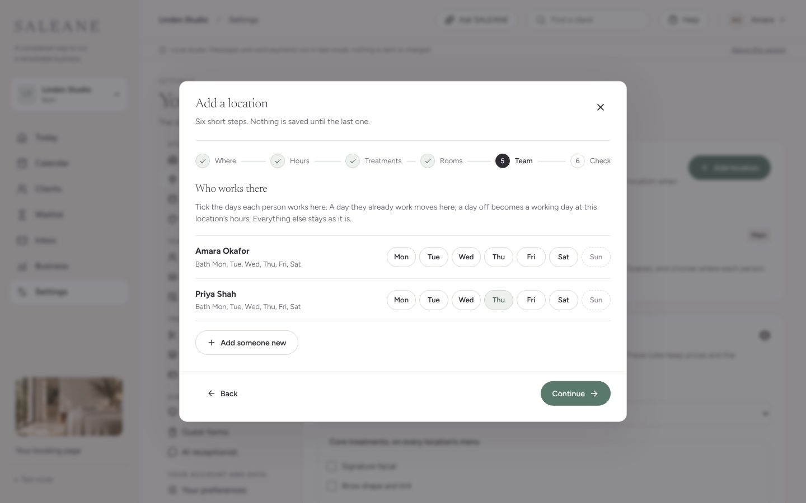
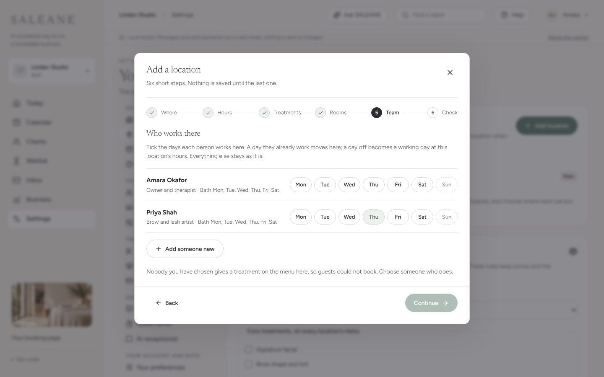
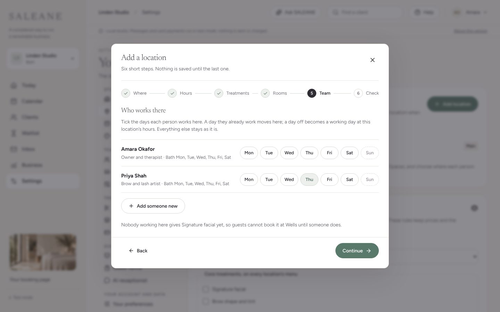

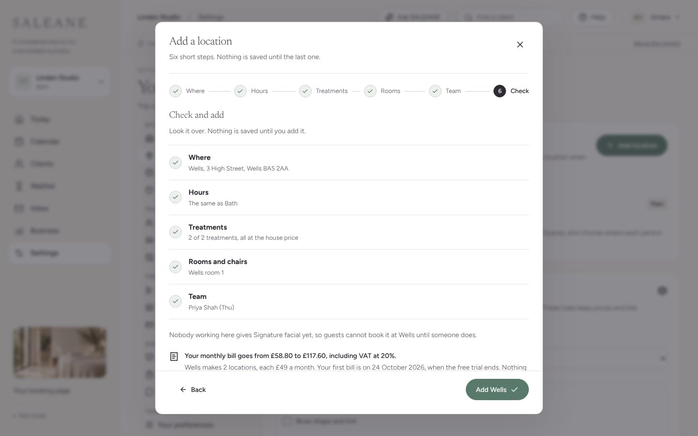
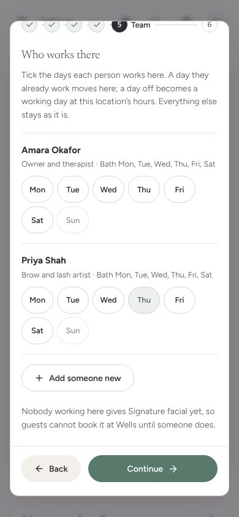

## Limits

- Adding a location says what the owner's own monthly bill becomes, read from Settings, Plan and billing (NEXT-02). Nothing is taken when it is added, because each month is billed in advance, and the screen says so, along with test mode for card payments. If the plan cannot be read, it shows the price for each location instead. A sample studio shows only the price and is never charged.
- The setup screens, the welcome and several app screens still borrow the existing house photographs. `docs/photo-prompts.md` holds 21 prompts, one for each of those screens, and one message to paste into ChatGPT for the whole set. The three empty photographs in the photo library pull request only need saving again from their originals.
- Setup asks for everyone to work the studio's opening hours to begin with; each person's own days stay in Settings under Team. Inviting the team to sign in also stays in Settings.
- A location's photograph, its own colours and moving existing rooms into it stay in Settings.
- The first weeks list remembers "I am starting fresh", "I work on my own", "The usual ones are right" and hiding in this browser only, like the ready list. Whether the team has been invited is read from the owner's team list, so managers do not see that step.
- The welcome shows once, when someone joins from an invitation. It is not shown again on later sign-ins or to people who joined before it existed.
