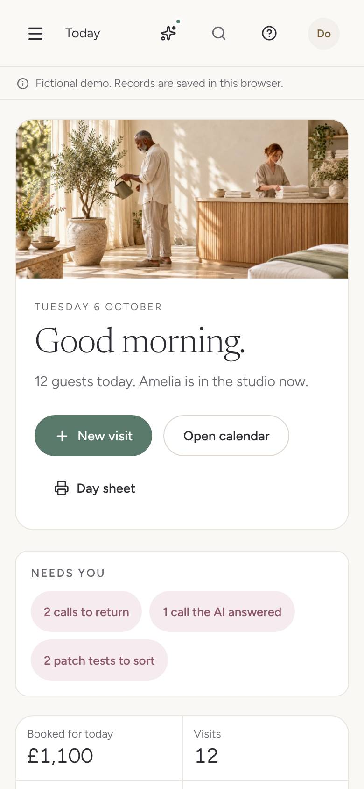
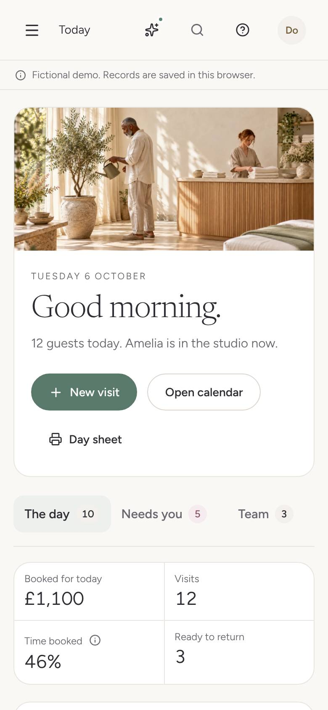
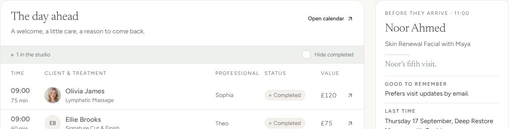
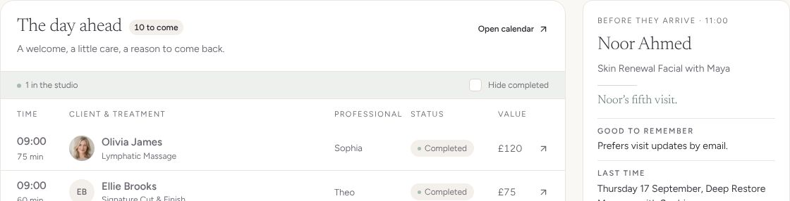
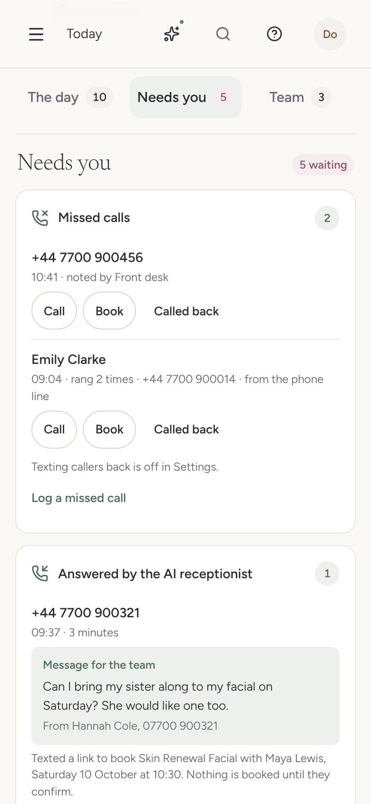
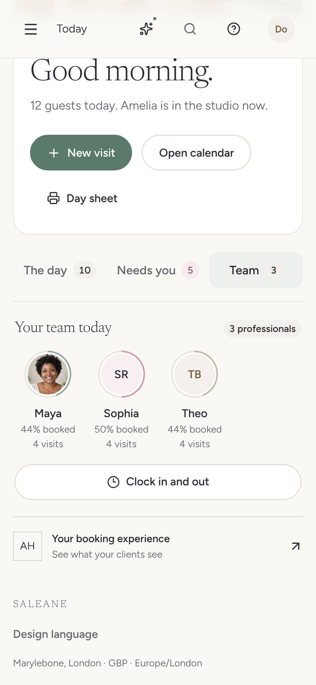

# NEXT-20 · Today on a phone, in three tabs with counts

Recorded 13 October 2026 on a local build (Chromium, 127.0.0.1:5173), in the browser demo (Atelier House, Tuesday 6 October 2026: 12 visits, 2 complete, 2 calls to return, 1 call the AI answered, 2 patch tests to sort, 3 professionals). "Before" is main at d22027b, with the tidier layout merged; "after" is this branch.

Before and after, on a phone and a computer: https://claude.ai/artifact/Xv79dRndVcMHq3zNWcoJaj (the page that showed the mock-up Edem said yes to on 13 October, now with the built screens). The rule is decision 18 and the Today on a phone pattern in [DESIGN_LANGUAGE.md](../DESIGN_LANGUAGE.md#patterns).

## What changed

| At 390px                | Before                                                                              | After                                                     |
| ----------------------- | ----------------------------------------------------------------------------------- | --------------------------------------------------------- |
| Under the greeting      | A Needs you strip: 2 calls to return, 1 call the AI answered, 2 patch tests to sort | Tabs: The day 10, Needs you 5 (soft rose), Team 3         |
| Page height             | 5,721px, all in one column                                                          | 3,945px on The day, 2,104px on Needs you, 1,122px on Team |
| Needs you's cards start | 2,646px down                                                                        | Directly under the tabs, one tap away                     |
| Your team today starts  | 3,966px down                                                                        | Directly under the tabs, one tap away                     |

At 320px the page was 6,253px and is now 4,376px on The day. On a computer the columns stay as they were; The day ahead, Needs you and Your team today each carry a count beside their heading.

| Before                                                   | After                                            |
| -------------------------------------------------------- | ------------------------------------------------ |
|        |        |
|  |  |

Needs you and Team on a phone:  

## One change from the mock-up

The mock-up showed the Needs you count as white on solid rose. White on `--rose` measures 3.5:1, under the 4.5:1 small text needs, so the count is soft rose (`--rose-soft`) with a deep rose figure (`--rose-ink`), 4.8:1, the same as the count beside the Needs you heading on a computer. The plain counts are ink on stone, 12.2:1.

## Tests

- `src/pages/todayTabs.test.tsx` (new). On a phone: a tab row named Today with The day "10 to come", Needs you "5 waiting" and Team "3 professionals" as each tab's name; only Needs you's count is marked for attention; Today opens on The day, whose heading count matches its tab; Needs you is not on the page until its tab is chosen, and the old strip is gone; logging a missed call from the tab shows 6 in the heading and in the tab at once; the arrow key moves on to Team, which shows the team and Your booking experience. On a computer: no tab row, and the three headings carry "N to come", "5 waiting" (marked for attention) and "3 professionals".
- `src/components/WaitingStrip.test.tsx` is removed with the strip.
- `todayColumn.test.tsx` and `moments.test.tsx` pass unchanged: the heading counts keep their words ("5 waiting") as plain text.

## Browser journey

1. 390px: the three tabs measure 116 to 118px wide and 44px tall. Choosing Needs you shows Needs you with "5 waiting" and its four cards; choosing Team shows the three professionals, Clock in and out, and Your booking experience. Nothing scrolls sideways.
2. 375px, 360px and 320px: the three tabs fit the row at 44px tall (at 360px and narrower their words are a size smaller and closer); nothing scrolls sideways. Before that rule was added, the row ran past the edge at 320px and the page scrolled sideways.
3. 651px, 768px and 1024px: no tabs; the columns and the three heading counts, with nothing sideways.
4. 1440px: the same columns as before; "10 to come" beside The day ahead, "5 waiting" in soft rose beside Needs you, "3 professionals" beside Your team today. No card sits inside a card and no panel has two primary buttons.
5. `/design-language`: the Tabs sample shows Team 3 and Requests 2 in soft rose.

## Not covered

Safari and Firefox were not checked. On Needs you, a few buttons inside the cards (Call, Book, Called back, Log a missed call) measure 40px tall at 390px, and the "How Time booked is measured" mark on The day 22px; both are the same on main and are not changed here. The tab remembers nothing between visits: Today always opens on The day.
